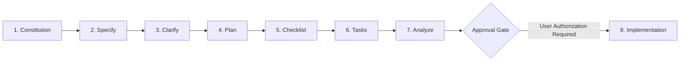
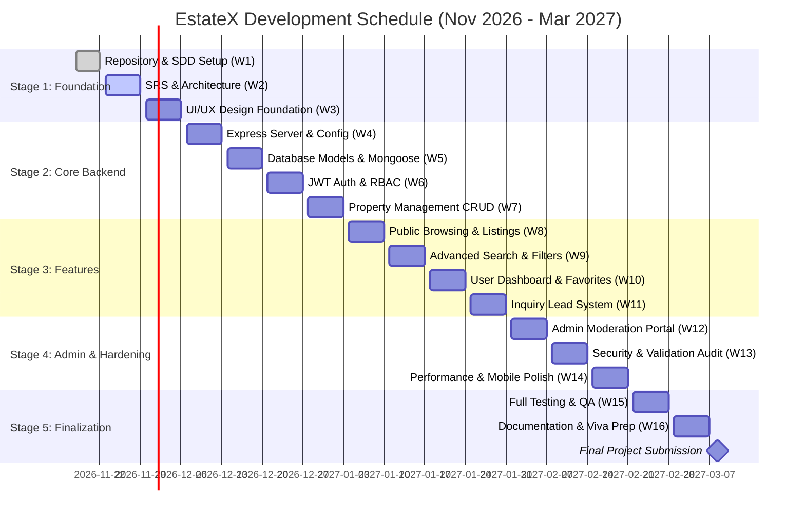

# ESTATEX — Real Estate & Rental Platform

[](https://github.com/github/spec-kit)
[](https://github.com/github/spec-kit)
[](https://antigravity.google)
[](#technology-stack)
[](#current-project-status--authorization-boundary)

---

## Academic Project Information

- **Project Name:** EstateX — Real Estate & Rental Platform
- **Student Developer:** Wasi Ashraf
- **Academic Institution:** Government College of Technology (GCT) Bhakkar, Punjab, Pakistan
- **Department:** Computer Information Technology (CIT)
- **Project Classification:** DAE CIT Final Year Capstone Project
- **Academic Session:** 2026–2027
- **Development Baseline Date:** 18 November 2026
- **Target Submission Date:** 8 March 2027
- **Project Location:** `D:\estatex`
- **Lead Methodology:** Spec-Driven Development (SDD) via GitHub Spec Kit & Google Antigravity

---

## Current Project Status & Authorization Boundary

> [!IMPORTANT]
> **CURRENT STAGE: SPECIFICATION, ARCHITECTURE & PLANNING COMPLETED.**  
> **CODE IMPLEMENTATION AUTHORIZATION: HELD.**  
> In accordance with the [Project Constitution](file:///D:/estatex/.specify/memory/constitution.md), all architectural designs, specifications, database schemas, API contracts, and task breakdowns are established. **No application coding, React component implementation, Express routing, or npm package installation is authorized until formal user sign-off.**

---

## Master Documentation Directory Navigation

All specifications and system designs are structured into specialized directories:

```
D:\estatex\
├── .agents/                    # Google Antigravity skills and project rules
├── .specify/                   # GitHub Spec Kit framework, templates & Constitution
├── docs/                       # Complete system documentation package
│   ├── INDEX.md                # Master Documentation Index
│   ├── 01-project-overview/    # Project Charter & Proposal Alignment
│   ├── 02-requirements/        # Functional & Non-Functional Requirements, RBAC
│   ├── 03-planning/            # 16-Week Roadmap & SDD Methodology Guide
│   ├── 04-architecture/        # 3-Tier Architecture, Frontend & Backend Specs
│   ├── 05-design/              # Design System Tokens & Wireframe Specs
│   ├── 06-database/            # MongoDB Schema Design & ERD
│   ├── 07-api/                 # RESTful API Specifications
│   ├── 08-security/            # Security Architecture & OWASP Top 10
│   ├── 09-testing/             # Testing Pyramid Strategy & Acceptance Gates
│   ├── 10-deployment/          # Deployment Topology & Environment Config
│   └── 11-project-reports/     # QA Consistency Audit & Academic Viva Summary
├── specs/                      # Module-wise Spec Kit specifications
│   └── modules/                # MOD-01 to MOD-13 module specifications
├── frontend/                   # React.js + Vite presentation layer documentation
├── backend/                    # Node.js + Express.js backend layer documentation
├── database/                   # MongoDB schemas and test seeders
├── testing/                    # Unit, Integration, and E2E test harness
├── deployment/                 # Docker blueprints and environment configs
├── project-management/         # RTM, WBS task breakdown, and milestones
└── EstateX/                    # Preserved historical codebase, prototype & docs
```

### Primary Documentation Links
- 📘 [Master Documentation Index](file:///D:/estatex/docs/INDEX.md)
- 📜 [EstateX Project Constitution](file:///D:/estatex/.specify/memory/constitution.md)
- 🛡️ [Antigravity Agent Rules](file:///D:/estatex/.agents/rules/project-rules.md)
- 📋 [Functional Requirements Specification](file:///D:/estatex/docs/02-requirements/functional-requirements.md)
- 🏛️ [High-Level System Architecture](file:///D:/estatex/docs/04-architecture/system-architecture.md)
- 💾 [Database Schema Design & ERD](file:///D:/estatex/docs/06-database/database-schema-design.md)
- 🔌 [RESTful API Specification](file:///D:/estatex/docs/07-api/api-specification.md)
- 🔗 [Requirements Traceability Matrix (RTM)](file:///D:/estatex/project-management/traceability/requirements-traceability-matrix.md)
- 📝 [Development Task Breakdown (WBS)](file:///D:/estatex/project-management/tasks/development-task-breakdown.md)
- 🔍 [Quality Assurance & Consistency Report](file:///D:/estatex/docs/11-project-reports/quality-assurance-report.md)

---

## 1. Project Overview & Scope

EstateX is a modern, verified real estate discovery and listing management platform built specifically for the Pakistani property market. It addresses fragmented classifieds, unstandardized pricing, and chaotic buyer-seller communication by delivering a unified, reliable platform.

### Approved Property Scope (Pakistan Domain)
1. **Houses** — Single/double story residences, portions, villas.
2. **Apartments** — Flats, studio units, residential complexes.
3. **Commercial Shops** — Retail outlets, main bazaar shops, commercial plazas.
4. **Residential Plots** — Developed plots, files, scheme allotments.
5. **Agricultural Land** — Farmland acreage, tubewell and canal water shares.

### Transaction Purposes Supported
- **For Sale** (Buying and Selling)
- **For Rent** (Rental leasing)

### Platform Roles & Personas
- **Visitor (Public):** Browse properties, filter by city/price, view specs and galleries.
- **Buyer / Renter (`user`):** Save favorite properties, submit inquiries, view contact history.
- **Seller / Property Owner (`seller`):** Publish listings, manage availability (`Active`, `Sold`, `Rented`), review leads inbox.
- **Administrator (`admin`):** Review and moderate listings, approve/reject submissions, govern user accounts, monitor KPIs.

---

## 2. Technology Stack

| Layer | Technology | Version | Purpose |
|---|---|---|---|
| **Frontend** | React.js | v18.x | Declarative Single Page Application (SPA) |
| **Tooling & Bundler** | Vite | v5.x | Ultra-fast local development and production bundle compilation |
| **Markup & Styling** | HTML5, CSS3 | Standard | Mobile-first responsive layouts, CSS design tokens |
| **Backend Runtime** | Node.js | v20+ (LTS) | High-performance asynchronous JavaScript engine |
| **API Framework** | Express.js | v4.x | RESTful API routing, middleware pipeline, security headers |
| **Database** | MongoDB | v7.x | Scalable document-oriented NoSQL persistence |
| **ODM Layer** | Mongoose | v8.x | Schema validation, business modeling, relational population |
| **Authentication** | JWT & bcrypt | Standard | Stateless token sessions, salted password hashing |
| **Validation** | Zod | v3.x | Strict runtime schema parsing and sanitization |
| **SDD Framework** | GitHub Spec Kit | v1.4.3 | Spec-Driven Development framework |
| **AI Partner** | Google Antigravity | v1.5+ | Agentic assistant, skills runner, SDD orchestrator |

---

## 3. Spec-Driven Development (SDD) Workflow

EstateX enforces the official GitHub Spec Kit lifecycle:



1. **Constitution:** Ratified binding charter in `.specify/memory/constitution.md`.
2. **Specify:** Comprehensive feature specification in `specs/modules/<module>/spec.md`.
3. **Clarify:** De-risking edge cases and requirements before planning.
4. **Plan:** Architectural blueprints, database schemas, and API contracts.
5. **Checklist:** Verification checklist ensuring complete acceptance criteria.
6. **Tasks:** Work Breakdown Structure (WBS) with dependencies and hours in `project-management/tasks/`.
7. **Analyze:** Cross-artifact consistency audit in `docs/11-project-reports/quality-assurance-report.md`.
8. **Implementation:** Strictly prohibited until explicit user approval is granted.

---

## 4. Master 16-Week Development Roadmap



---

## 5. Module Inventory (All 13 Modules Specified)

| Module ID | Module Name | Primary Role | Specification Path |
|---|---|---|---|
| **MOD-01** | Visitor Module | Visitor | [`specs/modules/01-visitor/spec.md`](file:///D:/estatex/specs/modules/01-visitor/spec.md) |
| **MOD-02** | Authentication Module | All Roles | [`specs/modules/02-auth/spec.md`](file:///D:/estatex/specs/modules/02-auth/spec.md) |
| **MOD-03** | Buyer / User Module | Buyer | [`specs/modules/03-buyer-user/spec.md`](file:///D:/estatex/specs/modules/03-buyer-user/spec.md) |
| **MOD-04** | Seller Module | Seller | [`specs/modules/04-seller/spec.md`](file:///D:/estatex/specs/modules/04-seller/spec.md) |
| **MOD-05** | Admin Moderation Module | Admin | [`specs/modules/05-admin/spec.md`](file:///D:/estatex/specs/modules/05-admin/spec.md) |
| **MOD-06** | Property Listing Module | Seller/Admin | [`specs/modules/06-property-listing/spec.md`](file:///D:/estatex/specs/modules/06-property-listing/spec.md) |
| **MOD-07** | Property Search & Filter Module | All Roles | [`specs/modules/07-property-search-filter/spec.md`](file:///D:/estatex/specs/modules/07-property-search-filter/spec.md) |
| **MOD-08** | Property Details Module | All Roles | [`specs/modules/08-property-details/spec.md`](file:///D:/estatex/specs/modules/08-property-details/spec.md) |
| **MOD-09** | Favorites Module | Buyer/Seller | [`specs/modules/09-favorites/spec.md`](file:///D:/estatex/specs/modules/09-favorites/spec.md) |
| **MOD-10** | Inquiry Module | Buyer/Seller | [`specs/modules/10-inquiry/spec.md`](file:///D:/estatex/specs/modules/10-inquiry/spec.md) |
| **MOD-11** | Property Image Management | Seller/Admin | [`specs/modules/11-image-management/spec.md`](file:///D:/estatex/specs/modules/11-image-management/spec.md) |
| **MOD-12** | Property Location Management | All Roles | [`specs/modules/12-location-management/spec.md`](file:///D:/estatex/specs/modules/12-location-management/spec.md) |
| **MOD-13** | Role-Specific Dashboards | All Auth Roles | [`specs/modules/13-dashboards/spec.md`](file:///D:/estatex/specs/modules/13-dashboards/spec.md) |

---

## 6. Preserved Historical Assets

The previous development foundation and prototype assets are preserved intact in `EstateX/`:
- `EstateX/prototype/` — Interactive static prototype (`project.html`, `project.css`, `project.js`, `about.html`, `contact.html`).
- `EstateX/frontend/` — Preliminary Vite scaffolding.
- `EstateX/backend/` — Preliminary Node/Express server skeleton.
- `EstateX/DOC/` — Previous daily logs, weekly modules, and initial roadmaps.

---

## 7. Project Motto

> **Plan Carefully. Specify Completely. Build Systematically. Test Continuously. Deliver Professionally.**

---
**Senior SDD Lead & CIT Final Year Student:** Wasi Ashraf  
**Academic Institution:** Government College of Technology (GCT) Bhakkar, Pakistan  
**Repository Working Directory:** `D:\estatex`
