# EstateX — Functional Requirements Specification (FRS)

**Document Reference:** FR-SPEC-2026-V1  
**Project:** EstateX Real Estate & Rental Platform  
**Status:** Approved Baseline  
**Methodology:** Spec-Driven Development (SDD)  

---

## 1. Requirements Overview & Classification

The functional requirements for EstateX are derived from the approved project proposal and categorized into thirteen core operational modules. Each requirement is assigned a unique identifier (`FR-MOD-XXX`), a priority level (Must Have, Should Have, Could Have), and associated user roles.

```mermaid
flowchart TD
    subgraph Users
        V[Visitor]
        U[Buyer / User]
        S[Seller / Owner]
        A[Administrator]
    end

    subgraph Core Modules
        M1[FR-VIS: Visitor Browsing]
        M2[FR-AUT: Authentication & RBAC]
        M3[FR-BUY: Buyer Account & Actions]
        M4[FR-SEL: Seller Management]
        M5[FR-ADM: Admin Moderation]
        M6[FR-LST: Property Listing Engine]
        M7[FR-SRC: Search & Filter Engine]
        M8[FR-DET: Property Details]
        M9[FR-FAV: Favorites System]
        M10[FR-INQ: Inquiry & Messaging]
        M11[FR-IMG: Image Handling]
        M12[FR-LOC: Location Handling]
        M13[FR-DSH: Role Dashboards]
    end

    V --> M1
    V --> M2
    V --> M7
    V --> M8
    U --> M2
    U --> M3
    U --> M8
    U --> M9
    U --> M10
    U --> M13
    S --> M2
    S --> M4
    S --> M6
    S --> M10
    S --> M11
    S --> M13
    A --> M2
    A --> M5
    A --> M6
    A --> M13
```

---

## 2. Module 01: Visitor Capabilities (FR-VIS)

| Req ID | Description | Role | Priority |
|---|---|---|---|
| **FR-VIS-001** | The platform shall allow unauthenticated visitors to view the landing homepage featuring hero search, recent listings, and category carousels. | Visitor | Must Have |
| **FR-VIS-002** | The platform shall allow visitors to browse all approved property listings in a responsive card grid/list view. | Visitor | Must Have |
| **FR-VIS-003** | The platform shall allow visitors to access individual property detail pages including specifications, descriptions, and photo galleries. | Visitor | Must Have |
| **FR-VIS-004** | The platform shall prompt unauthenticated visitors to log in or register when attempting to save a favorite or submit an inquiry. | Visitor | Must Have |
| **FR-VIS-005** | The platform shall display static informational pages including About Us, Contact, and Platform Disclaimer. | Visitor | Should Have |

---

## 3. Module 02: Authentication & Authorization (FR-AUT)

| Req ID | Description | Role | Priority |
|---|---|---|---|
| **FR-AUT-001** | The platform shall allow visitors to register as a `user` (buyer/renter) or `seller` with full name, valid email, mobile phone number, and secure password. | Public | Must Have |
| **FR-AUT-002** | Passwords must be hashed using `bcrypt` (minimum salt rounds 10) prior to persistent database storage. | System | Must Have |
| **FR-AUT-003** | The platform shall authenticate registered users via email and password, issuing a signed JSON Web Token (JWT) with standard expiration. | Public | Must Have |
| **FR-AUT-004** | The platform shall enforce Role-Based Access Control (RBAC) across three distinct role scopes: `user`, `seller`, and `admin`. | System | Must Have |
| **FR-AUT-005** | The platform shall allow authenticated users to invalidate their local session token securely (Logout). | Authenticated | Must Have |
| **FR-AUT-006** | The platform shall provide a secure token refresh or session validation endpoint for maintaining frontend client state. | Authenticated | Should Have |

---

## 4. Module 03: Buyer / User Management (FR-BUY)

| Req ID | Description | Role | Priority |
|---|---|---|---|
| **FR-BUY-001** | The platform shall provide an authenticated Buyer Profile management view to view and update contact details and preferences. | Buyer | Must Have |
| **FR-BUY-002** | The platform shall allow buyers to bookmark and unbookmark properties into a personal Favorites collection. | Buyer | Must Have |
| **FR-BUY-003** | The platform shall allow buyers to submit formal property inquiries directly to the listed seller. | Buyer | Must Have |
| **FR-BUY-004** | The platform shall provide buyers with an inquiry history log displaying past questions and seller response statuses. | Buyer | Must Have |

---

## 5. Module 04: Seller Management (FR-SEL)

| Req ID | Description | Role | Priority |
|---|---|---|---|
| **FR-SEL-001** | The platform shall allow registered sellers to create, publish, update, and soft-delete property listings. | Seller | Must Have |
| **FR-SEL-002** | The platform shall provide a Seller Management Dashboard displaying all owned properties categorized by status (`Active`, `Pending Review`, `Sold`, `Rented`). | Seller | Must Have |
| **FR-SEL-003** | The platform shall allow sellers to mark active properties as "Sold" or "Rented" to prevent unnecessary inquiries. | Seller | Must Have |
| **FR-SEL-004** | The platform shall provide sellers with an Inquiries Inbox to review buyer leads, contact info, and proposed visit dates. | Seller | Must Have |

---

## 6. Module 05: Admin Moderation & Governance (FR-ADM)

| Req ID | Description | Role | Priority |
|---|---|---|---|
| **FR-ADM-001** | The platform shall restrict access to administrative endpoints and portals strictly to users with the `admin` role. | Admin | Must Have |
| **FR-ADM-002** | The platform shall allow administrators to review newly submitted or edited property listings and set status to `Approved` or `Rejected`. | Admin | Must Have |
| **FR-ADM-003** | The platform shall allow administrators to suspend or deactivate fraudulent or violating user and seller accounts. | Admin | Must Have |
| **FR-ADM-004** | The platform shall provide administrators with a platform-wide metrics dashboard (total users, total sellers, active listings, pending approvals, total inquiries). | Admin | Must Have |

---

## 7. Module 06: Property Listing Engine (FR-LST)

| Req ID | Description | Role | Priority |
|---|---|---|---|
| **FR-LST-001** | The listing engine must support two commercial transaction purposes: `Sale` and `Rent`. | Seller/Admin | Must Have |
| **FR-LST-002** | The listing engine must support five primary Pakistan property categories: `House`, `Apartment`, `Commercial Shop`, `Residential Plot`, and `Agricultural Land`. | Seller/Admin | Must Have |
| **FR-LST-003** | The listing engine shall capture mandatory attributes: Title, Description, Purpose, Category, Price (PKR), Area/Size (Marla, Kanal, Sq. Ft.), City, Location Address, and Contact Details. | Seller | Must Have |
| **FR-LST-004** | The listing engine shall capture category-specific attributes (e.g., Bedrooms, Bathrooms, Floor Level for residential; Water Source, Tube-well, Soil Type for agricultural land). | Seller | Should Have |

---

## 8. Module 07: Property Search and Filter Engine (FR-SRC)

| Req ID | Description | Role | Priority |
|---|---|---|---|
| **FR-SRC-001** | The platform shall support keyword search matching property titles, descriptions, and localities. | Public | Must Have |
| **FR-SRC-002** | The platform shall filter listings by Purpose (`Sale`, `Rent`). | Public | Must Have |
| **FR-SRC-003** | The platform shall filter listings by Category (`House`, `Apartment`, `Shop`, `Plot`, `Agriculture`). | Public | Must Have |
| **FR-SRC-004** | The platform shall filter listings by Pakistani City / District (e.g., Bhakkar, Lahore, Rawalpindi, Islamabad, Multan). | Public | Must Have |
| **FR-SRC-005** | The platform shall filter listings by numerical Price Range (Minimum PKR and Maximum PKR). | Public | Must Have |
| **FR-SRC-006** | The platform shall support sorting results by: Price (Low to High, High to Low) and Date (Newest first). | Public | Must Have |
| **FR-SRC-007** | The search engine shall implement server-side pagination with limit and page parameters. | Public | Must Have |

---

## 9. Module 08: Property Details & Presentation (FR-DET)

| Req ID | Description | Role | Priority |
|---|---|---|---|
| **FR-DET-001** | The property details page shall render an image gallery with thumbnail selection and responsive zoom/carousel. | Public | Must Have |
| **FR-DET-002** | The details view shall display price formatted in Pakistani currency standard (e.g., Lakhs, Crores, or PKR commas). | Public | Must Have |
| **FR-DET-003** | The details view shall present key features: size/area in Marla/Kanal, bedrooms, bathrooms, and parking. | Public | Must Have |
| **FR-DET-004** | The details view shall provide an integrated seller contact card with phone and inquiry trigger. | Public | Must Have |

---

## 10. Module 09: Favorites Engine (FR-FAV)

| Req ID | Description | Role | Priority |
|---|---|---|---|
| **FR-FAV-001** | Authenticated buyers can toggle a favorite flag on any active property card or detail page. | Buyer | Must Have |
| **FR-FAV-002** | The platform shall prevent duplicate favorite entries using unique compound indexing (`userId` + `propertyId`). | System | Must Have |
| **FR-FAV-003** | Buyers can manage and purge items from their saved favorites view in the User Dashboard. | Buyer | Must Have |

---

## 11. Module 10: Inquiry & Communication Engine (FR-INQ)

| Req ID | Description | Role | Priority |
|---|---|---|---|
| **FR-INQ-001** | Authenticated buyers can transmit an inquiry payload containing: Name, Contact Phone, Email, Preferred Visit Date, and Message text. | Buyer | Must Have |
| **FR-INQ-002** | The platform shall validate all inquiry fields and attach the authenticated buyer ID and property ID. | System | Must Have |
| **FR-INQ-003** | The seller shall receive the inquiry in their seller dashboard with contact details for direct follow-up. | Seller | Must Have |
| **FR-INQ-004** | Sellers can update inquiry status to `New`, `Contacted`, or `Closed`. | Seller | Should Have |

---

## 12. Module 11: Property Image Management (FR-IMG)

| Req ID | Description | Role | Priority |
|---|---|---|---|
| **FR-IMG-001** | The platform shall support uploading between 1 and 10 property images per listing. | Seller | Must Have |
| **FR-IMG-002** | The upload pipeline shall validate MIME types (`image/jpeg`, `image/png`, `image/webp`) and limit file sizes to max 5MB per image. | System | Must Have |
| **FR-IMG-003** | Sellers can designate one primary thumbnail image for directory presentation. | Seller | Must Have |
| **FR-IMG-004** | Orphaned image records shall be deleted upon property removal. | System | Should Have |

---

## 13. Module 12: Location & Geo-Hierarchy (FR-LOC)

| Req ID | Description | Role | Priority |
|---|---|---|---|
| **FR-LOC-001** | The platform shall structure locations with standard hierarchy: Country (Pakistan) -> Province -> City / District -> Sector / Area / Mouza. | System | Must Have |
| **FR-LOC-002** | The platform shall store location coordinates (latitude/longitude) optionally for map display and localized search. | System | Should Have |
| **FR-LOC-003** | The platform shall index city and area fields to optimize query execution times. | System | Must Have |

---

## 14. Module 13: Role-Specific Dashboards (FR-DSH)

| Req ID | Description | Role | Priority |
|---|---|---|---|
| **FR-DSH-001** | The User Dashboard shall aggregate saved properties, submitted inquiries, and account settings. | Buyer | Must Have |
| **FR-DSH-002** | The Seller Dashboard shall aggregate listing performance metrics, active listings, pending listings, and received inquiries. | Seller | Must Have |
| **FR-DSH-003** | The Admin Dashboard shall aggregate platform-wide KPIs, listing approval queue, and user account status tables. | Admin | Must Have |
