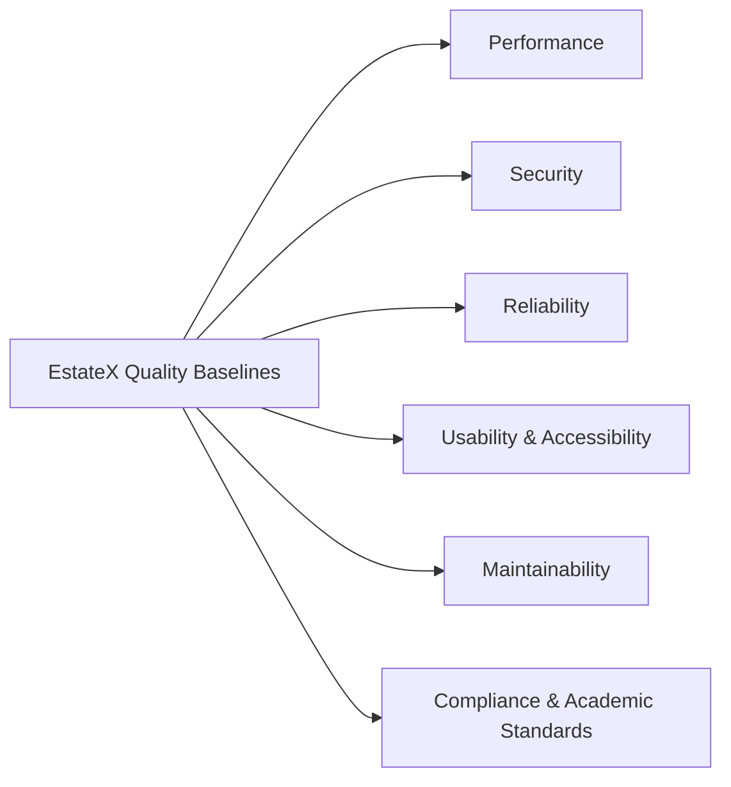

# EstateX — Non-Functional Requirements (NFR)

**Document Reference:** NFR-SPEC-2026-V1  
**Project:** EstateX Real Estate & Rental Platform  
**Status:** Approved Baseline  
**Academic Requirement:** DAE CIT Final Year Examination Standard  

---

## 1. Quality Attribute Matrix

The non-functional requirements define the quality attributes, architectural constraints, and performance baselines of the EstateX platform.

---

## 2. Performance & Responsiveness (NFR-PERF)

| ID | Requirement Metric | Target Baseline | Verification Method |
|---|---|---|---|
| **NFR-PERF-01** | API Response Latency | P95 < 250ms for indexed reads (listings, details) | Load testing via Postman / k6 |
| **NFR-PERF-02** | Database Query Execution | P95 < 50ms for paginated search queries | MongoDB Explain Plan analysis |
| **NFR-PERF-03** | Client Bundle Load Time | Initial page load (LCP) < 2.0s on standard 4G | Google Lighthouse / DevTools audit |
| **NFR-PERF-04** | Image Optimization | Images served in modern compressed format (WebP/JPEG) | Image pipeline audit |
| **NFR-PERF-05** | Pagination Caps | Maximum pagination limit enforced at 24 items per page | Automated API contract test |

---

## 3. Security & Data Protection (NFR-SEC)

| ID | Requirement Metric | Target Baseline | Verification Method |
|---|---|---|---|
| **NFR-SEC-01** | Password Cryptography | Stored using `bcrypt` with salt cost factor >= 10 | Security code review & DB audit |
| **NFR-SEC-02** | Stateless Authentication | Cryptographically signed JWT tokens with 24h expiration | Token validation test suite |
| **NFR-SEC-03** | API Rate Limiting | Max 100 requests / 15 minutes per IP on public endpoints; 10 / 15 min on `/auth/login` | Express rate limiter tests |
| **NFR-SEC-04** | Input Sanitization | All request bodies and parameters validated against Zod schemas | Schema fuzzing & injection tests |
| **NFR-SEC-05** | Injection Prevention | Zero raw string queries; parameterized Mongoose queries exclusively | Static analysis & code inspection |
| **NFR-SEC-06** | CORS Protection | Strict origin whitelisting allowing only registered frontend URLs | Security header test |
| **NFR-SEC-07** | Transport Security | HTTPS enforcement in staging/production deployments | TLS scanner verification |

---

## 4. Reliability & Availability (NFR-REL)

| ID | Requirement Metric | Target Baseline | Verification Method |
|---|---|---|---|
| **NFR-REL-01** | Graceful Degradation | Centralized Express error handler catches unhandled rejections without crashing server | Chaos testing / uncaught exception tests |
| **NFR-REL-02** | Database Fault Tolerance | Automatic Mongoose reconnect logic with exponential backoff | Database restart test |
| **NFR-REL-03** | Data Integrity | Cascading soft-delete flags for removed properties to prevent orphaned references | Relational consistency audit |

---

## 5. Usability & Accessibility (NFR-USE)

| ID | Requirement Metric | Target Baseline | Verification Method |
|---|---|---|---|
| **NFR-USE-01** | Mobile Responsiveness | Fully responsive down to 320px viewport width (smartphones, tablets, desktop) | Cross-device browser testing |
| **NFR-USE-02** | Pakistani Unit Support | Default area measurement in Marla and Kanal with optional square feet equivalent | UI format verification |
| **NFR-USE-03** | Currency Formatting | Pakistani numbering system representation (e.g., PKR 1.25 Crore, 85 Lakhs) | Localization unit test |
| **NFR-USE-04** | Visual Feedback | Immediate feedback for loading, empty search results, and error states | UI component review |

---

## 6. Maintainability & Code Quality (NFR-MNT)

| ID | Requirement Metric | Target Baseline | Verification Method |
|---|---|---|---|
| **NFR-MNT-01** | Modular Separation | Strict 3-tier layering: Presentation (React) -> Application/API (Express) -> Persistence (Mongoose) | Architectural audit |
| **NFR-MNT-02** | Code Cleanliness | ESLint and Prettier formatting standard across both frontend and backend | Automated linter run |
| **NFR-MNT-03** | Traceability | 100% of routes and controllers map to corresponding Spec Kit requirement ID | Traceability matrix check |

---

## 7. Academic & Evaluation Standards (NFR-ACA)

| ID | Requirement Metric | Target Baseline | Verification Method |
|---|---|---|---|
| **NFR-ACA-01** | DAE CIT Compliance | Complete documentation package matching GCT Bhakkar final-year project criteria | Faculty supervisor review |
| **NFR-ACA-02** | Demonstrability | Standalone runnable configuration with seed data for offline board examination | Local demonstration audit |
| **NFR-ACA-03** | SDD Methodology | Full Spec Kit artifact trail (Constitution, Specs, Plans, Checklists, Tasks) | Repository audit |
