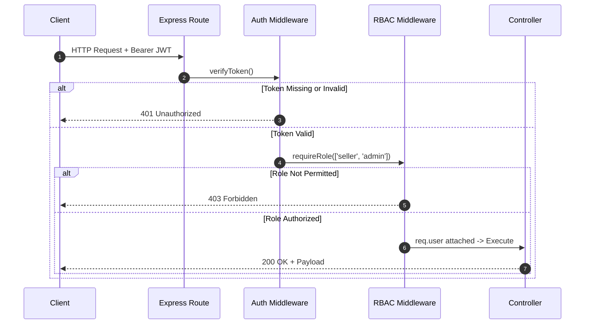

# EstateX — User Personas and Role-Based Access Control (RBAC)

**Document Reference:** RBAC-SPEC-2026-V1  
**Project:** EstateX Real Estate & Rental Platform  
**Status:** Approved Baseline  

---

## 1. User Personas

EstateX serves four distinct user archetypes representing key participants in the Pakistani property market.

### Persona 1: Tariq Mehmood (Prospective Home Buyer / Renter)
- **Role:** `user` (Buyer / Renter)
- **Profile:** 34-year-old professional living in Bhakkar, looking for a 5-Marla residential house for purchase or a 2-bedroom rental apartment for family relocation.
- **Pain Points:** Misleading prices on traditional classifieds, outdated listings, lack of clear seller contact channels.
- **Primary Goals:** Search properties with strict budget filters, inspect high-quality photos, save favorite shortlists, submit direct inquiries.

### Persona 2: Malik Arshad (Independent Property Seller & Landowner)
- **Role:** `seller` (Property Owner / Agent)
- **Profile:** 46-year-old agricultural landowner and commercial shop owner looking to list agricultural acreage and commercial rental spaces.
- **Pain Points:** Dealing with spam calls, difficulty showcasing specific agricultural traits (tubewell, canal water share), unorganized buyer leads.
- **Primary Goals:** Publish listings with detailed specifications, manage property status (`Active`, `Sold`, `Rented`), monitor buyer inquiry history.

### Persona 3: Zainab Bibi (Urban Apartment Renter)
- **Role:** `user` (Renter)
- **Profile:** 27-year-old educator moving to a new district, seeking a secure, verified 1-bedroom flat within a monthly rental budget of PKR 25,000 to 35,000.
- **Pain Points:** Hidden maintenance charges, unresponsiveness from brokers.
- **Primary Goals:** Filter specifically by `Rent`, review transparent property descriptions, contact owners directly.

### Persona 4: Wasi Ashraf (Platform Administrator & Moderator)
- **Role:** `admin` (Platform Operator)
- **Profile:** EstateX system administrator responsible for platform hygiene, content moderation, and operational oversight.
- **Pain Points:** Fake listings, duplicate spam posts, inappropriate imagery.
- **Primary Goals:** Moderate newly submitted listings, review flagged posts, manage user accounts, monitor system health and statistics.

---

## 2. Role-Based Access Control (RBAC) Matrix

The table below defines explicit operational permissions across the four system roles:

| Module / Operation | Visitor (Public) | Buyer (`user`) | Seller (`seller`) | Administrator (`admin`) |
|---|---|---|---|---|
| **View Homepage & Listings** | ALLOWED | ALLOWED | ALLOWED | ALLOWED |
| **Search & Apply Filters** | ALLOWED | ALLOWED | ALLOWED | ALLOWED |
| **View Property Details** | ALLOWED | ALLOWED | ALLOWED | ALLOWED |
| **Register & Sign In** | ALLOWED | ALLOWED | ALLOWED | ALLOWED |
| **Save / Unsave Favorites** | DENIED (Prompt Login) | ALLOWED | ALLOWED | ALLOWED |
| **Submit Property Inquiry** | DENIED (Prompt Login) | ALLOWED | ALLOWED | ALLOWED |
| **View Personal Inquiry Log** | DENIED | ALLOWED | ALLOWED | ALLOWED |
| **Create Property Listing** | DENIED | DENIED | ALLOWED | ALLOWED |
| **Edit Owned Listings** | DENIED | DENIED | ALLOWED | ALLOWED |
| **Delete Owned Listings** | DENIED | DENIED | ALLOWED | ALLOWED |
| **View Seller Inquiries Inbox** | DENIED | DENIED | ALLOWED | ALLOWED |
| **Approve / Reject Listings** | DENIED | DENIED | DENIED | ALLOWED |
| **Delete Any Listing** | DENIED | DENIED | DENIED | ALLOWED |
| **Suspend / Activate User** | DENIED | DENIED | DENIED | ALLOWED |
| **View Admin Dashboard KPIs** | DENIED | DENIED | DENIED | ALLOWED |

---

## 3. JWT Token Claims and Session Architecture

Authentication is stateless and implemented via standard Bearer tokens:

```json
{
  "sub": "654f1a2b3c4d5e6f7a8b9c0d",
  "name": "Malik Arshad",
  "email": "arshad@example.com",
  "role": "seller",
  "iat": 1732104000,
  "exp": 1732190400
}
```

### Authorization Middleware Pipeline

