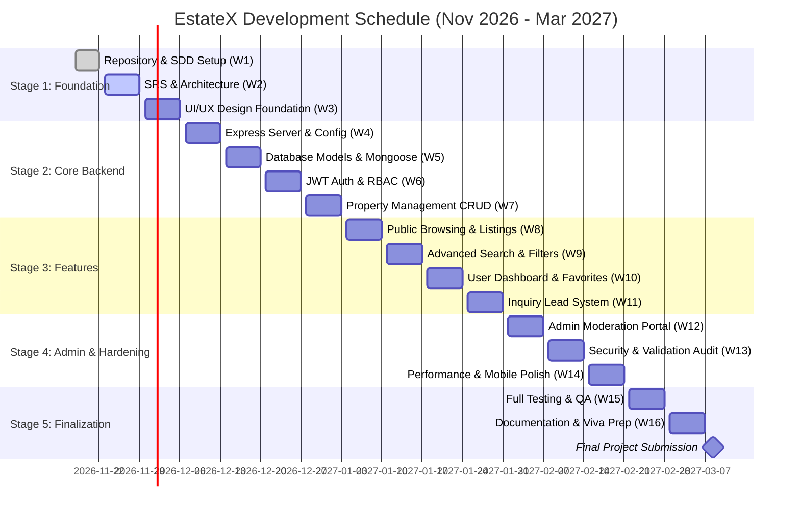

# EstateX — Master Development Roadmap (16-Week SDD Schedule)

**Project Name:** EstateX — Real Estate & Rental Platform  
**Student:** Wasi Ashraf  
**Academic Schedule:** 18 November 2026 – 8 March 2027  
**Total Duration:** 16 Academic Weeks + Final Viva Day  

---

## 1. Stage-Wise Breakdown

| Stage | Weeks | Primary Focus | Gate Review Deliverables |
|---|---|---|---|
| **Stage 1** | Week 01–03 | Foundation, SDD Specs & UI/UX | Project Constitution, SRS, System Architecture, Wireframes |
| **Stage 2** | Week 04–07 | Backend Engine, DB & Authentication | Express Server, MongoDB Schemas, JWT Auth, Property CRUD |
| **Stage 3** | Week 08–11 | Main Platform & Interaction Engines | Public Directory, Search/Filters, Favorites, Inquiries |
| **Stage 4** | Week 12–14 | Admin Moderation & Optimization | Admin Dashboard, Image Optimization, Security Hardening |
| **Stage 5** | Week 15–16 | Integration Testing, Demo & Submission | E2E Tests, Seed Data, Academic Thesis, Final Presentation |

---

## 2. Detailed Milestone Timeline

