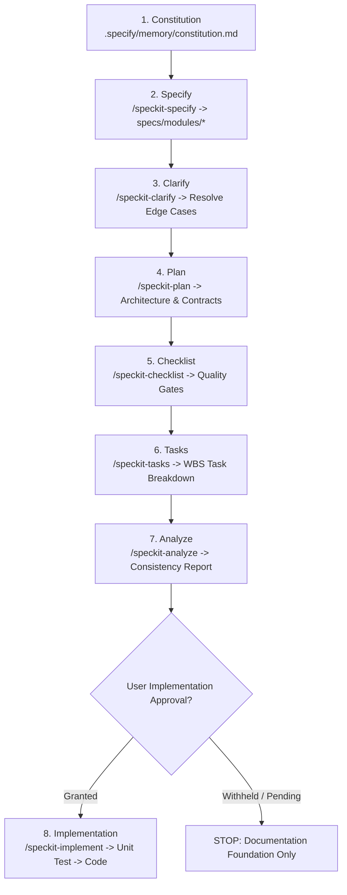

# EstateX — Spec-Driven Development (SDD) Methodology Guide

**Project:** EstateX Real Estate & Rental Platform  
**Governing Standard:** GitHub Spec Kit & Google Antigravity  

---

## 1. What is Spec-Driven Development (SDD)?

Spec-Driven Development is an engineering discipline where **specifications are executable, verified blueprints that precede all coding**. Rather than writing code and subsequently trying to document it, SDD treats specifications, technical plans, and quality checklists as primary engineering assets.

In EstateX, SDD guarantees:
1. **Zero Scope Creep:** Every line of code written in later stages must trace back to an approved requirement in the proposal.
2. **Defect Prevention:** Ambiguities, missing validation rules, and permission flaws are resolved during the specification phase rather than during testing.
3. **Deterministic Verification:** Features are developed directly against unambiguous acceptance tests.

---

## 2. The Spec Kit Lifecycle in EstateX

---

## 3. Antigravity Integration & Skills Usage

The project integrates GitHub Spec Kit skills directly into Google Antigravity:

- `/speckit-constitution` — Enforces core project constraints, tech stack lock, and scope boundaries.
- `/speckit-specify` — Generates feature specifications adhering to standard templates.
- `/speckit-clarify` — Structured questioning protocol to resolve ambiguous business rules before planning.
- `/speckit-plan` — Develops technical implementation plans, schema blueprints, and API contracts.
- `/speckit-checklist` — Formulates acceptance checklists for quality assurance.
- `/speckit-tasks` — Deconstructs implementation plans into dependency-linked atomic work units.
- `/speckit-analyze` — Audits cross-artifact consistency between requirements, specs, and tasks.
- `/speckit-implement` — **RESTRICTED.** Only activated after user issues formal implementation approval.
