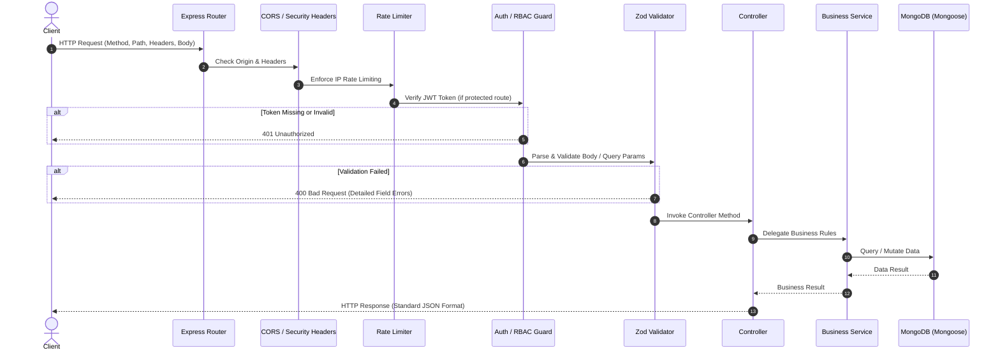

# EstateX — Backend Architecture Specification

**Document Reference:** ARCH-BE-2026-V1  
**Project:** EstateX Real Estate & Rental Platform  
**Technology:** Node.js, Express.js, MongoDB, Mongoose  

---

## 1. Backend Structure & Directory Organization

The backend service follows the **Controller-Service-Repository** pattern with dedicated middleware and validation layers:

```
backend/
├── src/
│   ├── config/             # DB connection, environment loaders, constants
│   ├── controllers/        # Request orchestration & HTTP response mapping
│   │   ├── auth/           # Login, Register, Profile, Token Refresh
│   │   ├── property/       # CRUD listings, Search, Status updates
│   │   ├── inquiry/        # Submit inquiry, Seller inbox, Status toggle
│   │   ├── favorite/       # Toggle favorite, Get user favorites
│   │   └── admin/          # User moderation, Listing approval, Platform stats
│   ├── middleware/         # Auth, RBAC, Error Handling, File Upload, Rate Limiting
│   ├── models/             # Mongoose schemas and model definitions
│   │   ├── User.js         # User, Seller, Admin identities
│   │   ├── Property.js     # Property listings and specs
│   │   ├── Inquiry.js      # Buyer inquiries
│   │   └── Favorite.js     # User saved properties
│   ├── routes/             # Express Route declarations
│   │   ├── authRoutes.js
│   │   ├── propertyRoutes.js
│   │   ├── inquiryRoutes.js
│   │   ├── favoriteRoutes.js
│   │   └── adminRoutes.js
│   ├── services/           # Business logic, query builders, image pipelines
│   ├── utils/              # Custom APIError class, response formatters, logger
│   └── validators/         # Zod input validation schemas
├── tests/                  # Unit and integration test suites
├── .env.example            # Environment template
├── package.json            # Node.js manifest
└── server.js               # Application bootstrap and server entry point
```

---

## 2. Request-Response Lifecycle Pipeline

Every incoming HTTP request undergoes a standardized multi-stage pipeline:



---

## 3. Standardized API Response Contract

All backend endpoints emit predictable JSON payloads:

### Success Response Envelope:
```json
{
  "success": true,
  "statusCode": 200,
  "message": "Properties retrieved successfully",
  "data": {
    "properties": [],
    "pagination": {
      "total": 120,
      "page": 1,
      "limit": 12,
      "totalPages": 10
    }
  }
}
```

### Error Response Envelope:
```json
{
  "success": false,
  "statusCode": 400,
  "error": {
    "code": "VALIDATION_ERROR",
    "message": "Invalid input data provided",
    "details": [
      {
        "field": "price",
        "issue": "Price must be a positive number greater than 0"
      }
    ]
  }
}
```
