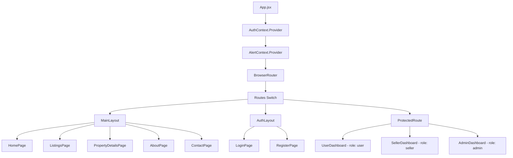

# EstateX — Frontend Architecture Specification

**Document Reference:** ARCH-FE-2026-V1  
**Project:** EstateX Real Estate & Rental Platform  
**Technology:** React.js, Vite, HTML5, CSS3  

---

## 1. Frontend Structure & Directory Organization

The React frontend utilizes a modular, feature-oriented structure designed for maintainability and scalability:

```
frontend/
├── public/                 # Static assets, favicon, site manifest
├── src/
│   ├── assets/             # Brand logos, placeholder graphics, icons
│   ├── components/         # Reusable component library
│   │   ├── common/         # Buttons, Inputs, Cards, Modals, Badges, Spinners
│   │   ├── navigation/     # Navbar, Mobile Drawer, Footer, Breadcrumbs
│   │   └── property/       # PropertyCard, ImageGallery, FilterSidebar, ContactModal
│   ├── context/            # React Context providers (AuthContext, AlertContext)
│   ├── hooks/              # Custom hooks (useAuth, useFetch, useDebounce)
│   ├── layouts/            # Page shell layouts (MainLayout, DashboardLayout, AdminLayout)
│   ├── pages/              # Routed view components
│   │   ├── public/         # Home, Listings, PropertyDetails, About, Contact
│   │   ├── auth/           # Login, Register, Unauthorized
│   │   └── dashboard/      # UserDashboard, SellerDashboard, AdminDashboard
│   ├── routes/             # AppRoutes config & ProtectedRoute guards
│   ├── services/           # Axios HTTP client instances and API endpoints
│   ├── styles/             # Global CSS design tokens, variables, typography
│   ├── App.jsx             # Root application orchestrator
│   └── main.jsx            # React 18 DOM mount point
├── index.html              # HTML5 entry template
├── package.json            # Frontend metadata and scripts
└── vite.config.js          # Vite build tool configuration
```

---

## 2. Component Hierarchy and Routing Architecture



---

## 3. State Management Strategy

1. **Authentication State:** Managed centrally via `AuthContext`. Stores the authenticated user profile, active token, and role permissions. Persisted securely in `localStorage` with automatic hydration on application mount.
2. **Server State & Data Fetching:** Managed through centralized services (`src/services/api.js`) and reusable `useFetch` hooks with loading, error, and data payload states.
3. **Form State:** Standard React controlled components paired with client-side validation prior to API transmission.
4. **UI State:** Local state (`useState`, `useReducer`) for toggles, drawers, gallery indices, and filter selectors.

---

## 4. Design System & CSS Architecture

- **Color Palette:**
  - Primary Brand: Deep Emerald / Teal (`#0F766E` / `#0D9488`) representing trust, land, and stability.
  - Accent / Action: Amber Gold (`#F59E0B`) for calls to action, featured badges, and ratings.
  - Background Neutral: Slate light (`#F8FAFC`) with dark neutral text (`#0F172A`).
  - System States: Success (`#10B981`), Warning (`#F59E0B`), Error (`#EF4444`).
- **Typography:** Modern clean sans-serif (`Inter`, system fallbacks) for optimal legibility across mobile and desktop viewports.
- **Responsive Breakpoints:**
  - Mobile: `< 640px`
  - Tablet: `640px – 1024px`
  - Desktop: `> 1024px`
