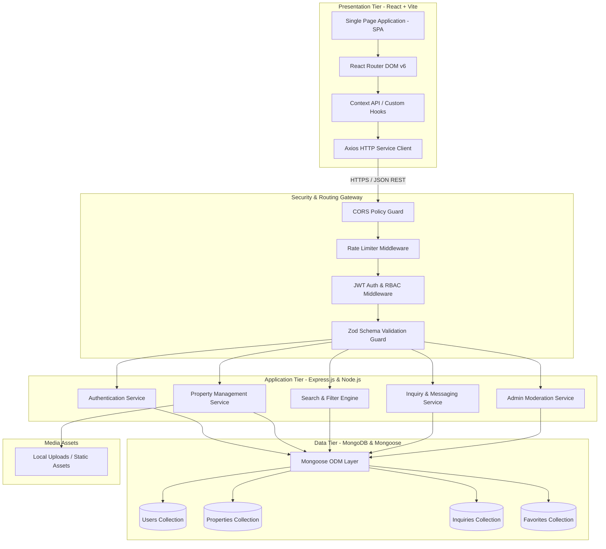

# EstateX — High-Level System Architecture

**Document Reference:** ARCH-SYS-2026-V1  
**Project:** EstateX Real Estate & Rental Platform  
**Methodology:** Spec-Driven Development (SDD)  

---

## 1. System Topology & Architectural Style

EstateX utilizes a decoupled **Client-Server 3-Tier Web Architecture** built on the modern MERN ecosystem (MongoDB, Express.js, React.js, Node.js). 

---

## 2. Key Architectural Decisions (ADR Summary)

### ADR-01: Decoupled RESTful API
- **Decision:** Separate the React frontend client from the Express backend server completely.
- **Rationale:** Ensures clean separation of concerns, enables independent testing, aligns with professional engineering practices, and allows potential future mobile client integration (e.g. Flutter).

### ADR-02: Stateless JWT Authentication
- **Decision:** Utilize JSON Web Tokens transmitted via standard HTTP Authorization headers.
- **Rationale:** Eliminates server-side session state in Node.js, facilitates horizontal scalability, and simplifies testing with automated HTTP runners (Postman / CI).

### ADR-03: Document-Oriented Schema Design with Mongoose
- **Decision:** Store property listings as flexible JSON documents with embedded specifications and referenced relations (User IDs).
- **Rationale:** Real estate attributes vary across property categories (e.g., houses need bedroom/bathroom counts; agricultural land requires water shares and tubewell info). MongoDB handles semi-structured property documents naturally.

### ADR-04: Strict Runtime Contract Validation with Zod
- **Decision:** Validate all incoming HTTP payloads at the gateway middleware level before invoking controllers.
- **Rationale:** Prevents corrupted data, injection vectors, and ensures that controllers operate on strictly typed, trusted input.
