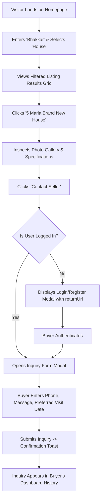
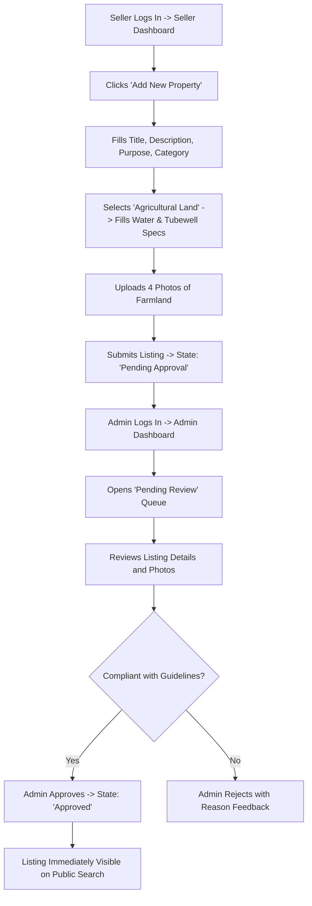

# EstateX — User Journeys & Wireframe Specifications

**Document Reference:** UX-WIREFRAME-2026-V1  
**Project:** EstateX Real Estate & Rental Platform  

---

## 1. Key User Journeys

### User Journey 1: Property Discovery & Lead Inquiry (Buyer)


### User Journey 2: Listing Publishing & Approval (Seller & Admin)


---

## 2. Low-Fidelity ASCII Wireframe Blueprints

### 2.1 Public Homepage
```
+-----------------------------------------------------------------------------------+
|  [EstateX Logo]   Explore   For Sale   For Rent   About   Contact   [Login] [Register]|
+-----------------------------------------------------------------------------------+
|                                                                                   |
|                   Find Your Dream Property in Pakistan                            |
|             Discover verified houses, apartments, shops, plots & farmland         |
|                                                                                   |
|   +---------------------------------------------------------------------------+   |
|   | [ City: Bhakkar v ] [ Purpose: Sale v ] [ Category: House v ] [ Search ]  |   |
|   +---------------------------------------------------------------------------+   |
|                                                                                   |
+-----------------------------------------------------------------------------------+
|  FEATURED PROPERTIES                                                              |
|  +-------------------+  +-------------------+  +-------------------+              |
|  | [House Photo]     |  | [Apartment Photo] |  | [Shop Photo]      |              |
|  | PKR 85 Lakhs      |  | PKR 35,000 / mo   |  | PKR 45 Lakhs      |              |
|  | 5 Marla House     |  | 2 Bed Apartment   |  | Commercial Shop   |              |
|  | Canal View, Bhakkar| | F-11, Islamabad   |  | Main Bazar, Bhakkar|             |
|  +-------------------+  +-------------------+  +-------------------+              |
+-----------------------------------------------------------------------------------+
|  BROWSE BY CATEGORY                                                               |
|  [ Houses ]  [ Apartments ]  [ Commercial Shops ]  [ Plots ]  [ Agricultural Land]|
+-----------------------------------------------------------------------------------+
```

### 2.2 Seller Dashboard
```
+-----------------------------------------------------------------------------------+
|  [EstateX Seller]   My Listings   Inquiries (3 New)   Profile   [Logout]           |
+-----------------------------------------------------------------------------------+
|  SELLER DASHBOARD OVERVIEW                                                        |
|  [ Total Listings: 5 ]   [ Active: 3 ]   [ Pending: 1 ]   [ Inquiries: 12 ]       |
+-----------------------------------------------------------------------------------+
|  MY PROPERTIES                              [ + Add New Property Button ]         |
|  +-----------------------------------------------------------------------------+  |
|  | Image | Title                       | Price        | Status    | Actions    |  |
|  |-------|-----------------------------|--------------|-----------|------------|  |
|  | [img] | 5 Marla House Canal View    | 85 Lakhs     | Active    | Edit|Delete|  |
|  | [img] | 12 Acre Farmland Darya Khan | 1.8 Crore    | Pending   | Edit|Delete|  |
|  | [img] | Main Bazar Shop             | 45 Lakhs     | Sold      | View       |  |
|  +-----------------------------------------------------------------------------+  |
+-----------------------------------------------------------------------------------+
```
