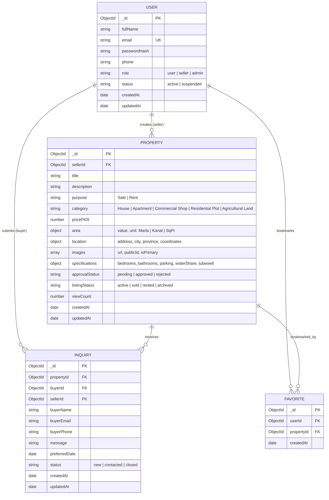

# EstateX — Database Schema Design & Data Models

**Document Reference:** DB-SPEC-2026-V1  
**Database Engine:** MongoDB v7.0+  
**Object Data Modeling (ODM):** Mongoose v8.0+  
**Design Paradigm:** Document-Oriented Relational-Hybrid Model  

---

## 1. Entity-Relationship Diagram (ERD)



---

## 2. Collection Schemas & Field Definitions

### 2.1 `users` Collection

| Field Name | Type | Constraints | Description |
|---|---|---|---|
| `_id` | `ObjectId` | Primary Key, Auto-generated | Unique user identifier |
| `fullName` | `String` | Required, Trimmed, Max 100 | Legal name of user/seller |
| `email` | `String` | Required, Unique, Lowercase, Indexed | Contact & authentication email |
| `passwordHash` | `String` | Required | bcrypt salted hash |
| `phone` | `String` | Required, Pakistani format (`+92...` or `03...`) | Direct contact phone |
| `role` | `String` | Enum: `['user', 'seller', 'admin']`, Default: `'user'` | RBAC authorization scope |
| `status` | `String` | Enum: `['active', 'suspended']`, Default: `'active'` | Account moderation state |
| `createdAt` | `Date` | Timestamp | Account creation timestamp |
| `updatedAt` | `Date` | Timestamp | Last profile update timestamp |

### 2.2 `properties` Collection

| Field Name | Type | Constraints | Description |
|---|---|---|---|
| `_id` | `ObjectId` | Primary Key, Auto-generated | Unique listing identifier |
| `sellerId` | `ObjectId` | Ref: `User`, Required, Indexed | Creator/owner reference |
| `title` | `String` | Required, Trimmed, Max 150 | Headline listing title |
| `description` | `String` | Required, Trimmed, Max 3000 | Detailed property narrative |
| `purpose` | `String` | Enum: `['Sale', 'Rent']`, Indexed | Commercial transaction type |
| `category` | `String` | Enum: `['House', 'Apartment', 'Commercial Shop', 'Residential Plot', 'Agricultural Land']`, Indexed | Property classification |
| `pricePKR` | `Number` | Required, Min: 1, Indexed | Listing price in PKR |
| `area.value` | `Number` | Required, Min: 0.1 | Numerical area measurement |
| `area.unit` | `String` | Enum: `['Marla', 'Kanal', 'SqFt']`, Default: `'Marla'` | Land measurement unit |
| `location.address`| `String` | Required, Trimmed | Street / locality address |
| `location.city` | `String` | Required, Indexed | City / District (e.g. Bhakkar) |
| `location.province`| `String`| Required, Default: `'Punjab'` | Pakistani province |
| `images` | `Array` | Min 1, Max 10 items | Uploaded photo records |
| `specifications` | `Object` | Semi-structured | Category-specific attributes |
| `approvalStatus`| `String` | Enum: `['pending', 'approved', 'rejected']`, Default: `'pending'`, Indexed | Admin moderation state |
| `listingStatus` | `String` | Enum: `['active', 'sold', 'rented', 'archived']`, Default: `'active'`, Indexed | Commercial availability |
| `viewCount` | `Number` | Default: 0 | Total impressions count |

### 2.3 `inquiries` Collection

| Field Name | Type | Constraints | Description |
|---|---|---|---|
| `_id` | `ObjectId` | Primary Key, Auto-generated | Unique inquiry identifier |
| `propertyId` | `ObjectId` | Ref: `Property`, Required, Indexed | Inquired listing |
| `buyerId` | `ObjectId` | Ref: `User`, Required, Indexed | Inquiring buyer |
| `sellerId` | `ObjectId` | Ref: `User`, Required, Indexed | Target property seller |
| `buyerName` | `String` | Required | Contact name |
| `buyerEmail` | `String` | Required | Contact email |
| `buyerPhone` | `String` | Required | Contact phone |
| `message` | `String` | Required, Max 1000 | Inquirer's message |
| `preferredDate`| `Date` | Optional | Proposed property visit date |
| `status` | `String` | Enum: `['new', 'contacted', 'closed']`, Default: `'new'` | Seller lead status |

### 2.4 `favorites` Collection

| Field Name | Type | Constraints | Description |
|---|---|---|---|
| `_id` | `ObjectId` | Primary Key, Auto-generated | Unique favorite identifier |
| `userId` | `ObjectId` | Ref: `User`, Required, Indexed | Bookmarking user |
| `propertyId` | `ObjectId` | Ref: `Property`, Required, Indexed | Bookmarked property |
| `createdAt` | `Date` | Timestamp | Bookmark timestamp |

---

## 3. Database Indexes

To achieve high-performance query latency under 50ms, the following indexes are specified:

```javascript
// Properties Collection Indexes
db.properties.createIndex({ approvalStatus: 1, listingStatus: 1, createdAt: -1 });
db.properties.createIndex({ "location.city": 1, category: 1, purpose: 1 });
db.properties.createIndex({ pricePKR: 1 });
db.properties.createIndex({ sellerId: 1, createdAt: -1 });
db.properties.createIndex({ title: "text", description: "text" });

// Users Collection Indexes
db.users.createIndex({ email: 1 }, { unique: true });
db.users.createIndex({ role: 1 });

// Favorites Collection Indexes (Compound Unique to prevent duplicate bookmarks)
db.favorites.createIndex({ userId: 1, propertyId: 1 }, { unique: true });

// Inquiries Collection Indexes
db.inquiries.createIndex({ sellerId: 1, createdAt: -1 });
db.inquiries.createIndex({ buyerId: 1, createdAt: -1 });
```
