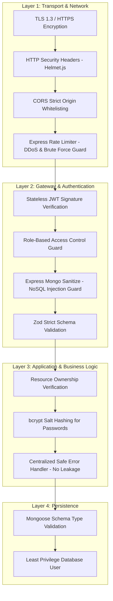

# EstateX — Security Architecture & Guidelines

**Document Reference:** SEC-SPEC-2026-V1  
**Project:** EstateX Real Estate & Rental Platform  
**Compliance Standard:** OWASP Top 10 Web Application Security  

---

## 1. Security Architecture Overview

EstateX implements Defense-in-Depth across transport, network gateway, application logic, and database persistence layers:



---

## 2. Authentication & Credential Security

1. **Password Hashing:**
   - Algorithm: `bcrypt` with automatic salting.
   - Cost Factor (Salt Rounds): **10** (balances computational security against CPU resource utilization).
   - Raw passwords are never logged, cached, or returned in API responses.
2. **JWT Token Signing:**
   - Algorithm: HMAC SHA-256 (`HS256`).
   - Secret Management: Cryptographically random 64-character secret loaded exclusively from environment variables (`JWT_SECRET`).
   - Lifetime: Set to standard 24 hours (`24h`) to mitigate token hijacking window.

---

## 3. Role-Based Access Control (RBAC) Enforcement

The backend enforces RBAC at the route handler level using modular middleware:

```javascript
// Middleware specification pattern
const authorizeRoles = (...allowedRoles) => {
  return (req, res, next) => {
    if (!req.user || !allowedRoles.includes(req.user.role)) {
      return res.status(403).json({
        success: false,
        statusCode: 403,
        error: {
          code: "FORBIDDEN",
          message: "You do not possess the required permissions for this action"
        }
      });
    }
    next();
  };
};
```

---

## 4. OWASP Top 10 Mitigation Matrix

| OWASP Vulnerability | Threat Description | EstateX Safeguard |
|---|---|---|
| **A01: Broken Access Control** | User accesses unauthorized records | Middleware verifies JWT role AND checks that `sellerId === req.user.id` on property mutations. |
| **A02: Cryptographic Failures** | Storing plain or weakly hashed passwords | Enforced bcrypt hashing with salt; HTTPS transport enforcement. |
| **A03: Injection (NoSQL / XSS)** | Malicious query operators in inputs | `express-mongo-sanitize` strips `$` and `.` operators; Zod strips unexpected fields. |
| **A04: Insecure Design** | Unmoderated fake listings | Multi-stage status pipeline (`pending` -> `approved`) requires Admin review. |
| **A05: Security Misconfiguration** | Information disclosure via stack traces | Production error handler suppresses error stacks and returns sanitized error envelopes. |
| **A06: Vulnerable Components** | Outdated packages with CVEs | Regular `npm audit` and lockfile pinning during dependency setup. |
| **A07: Identification Failures** | Brute force login attacks | IP-based rate limiting on `/api/v1/auth/login` (max 10 attempts per 15 minutes). |
| **A08: Software / Data Integrity** | Corrupted inputs | Strict schema validation before reaching business services. |
| **A09: Logging & Monitoring** | Undetected failures | Structured JSON logging for critical events (failed logins, role changes). |
| **A10: Server-Side Request Forgery**| Server making unauthorized outbound calls | Application makes zero external outbound requests; image uploads restricted to validated storage. |
