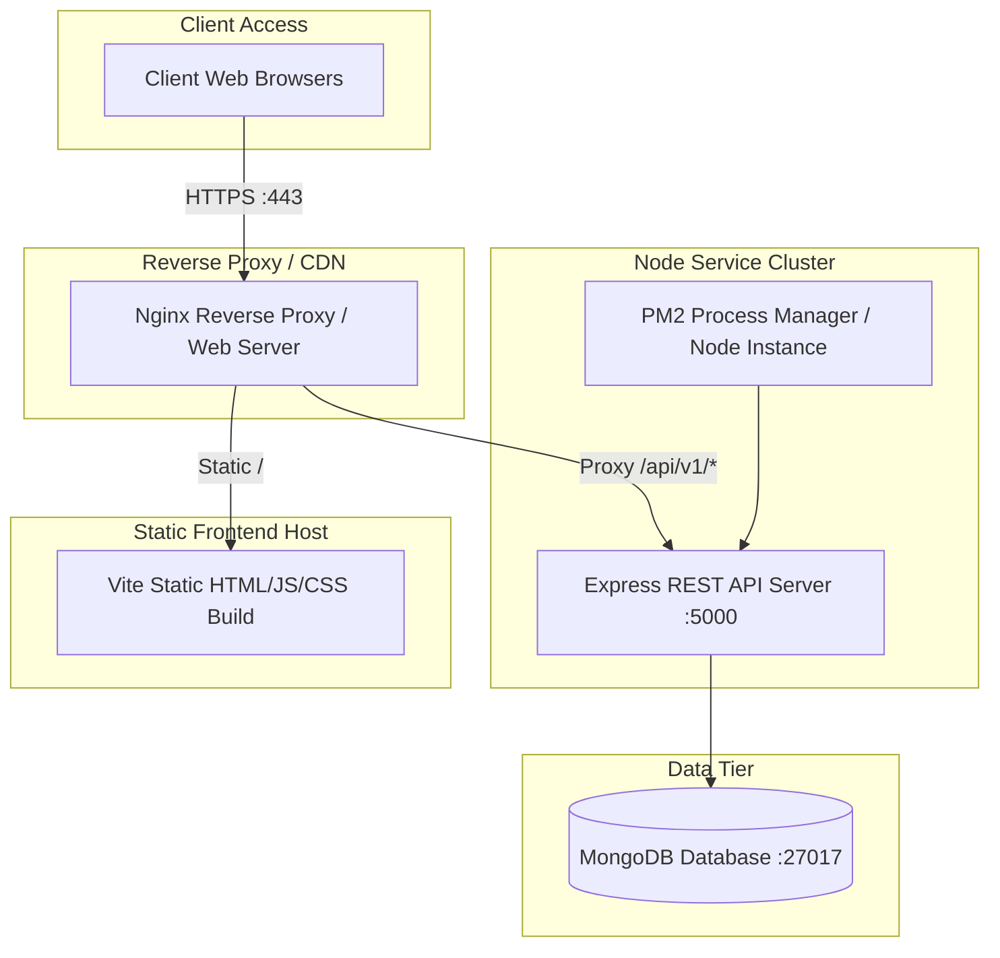

# EstateX — Deployment Architecture & Environment Configuration

**Document Reference:** DEPL-SPEC-2026-V1  
**Project:** EstateX Real Estate & Rental Platform  
**Target Environments:** Local Development | Academic Evaluation Demo | Production  

---

## 1. Deployment Topology

EstateX is designed for containerized or standard Node.js process manager deployment:



---

## 2. Environment Variables Specification

Both frontend and backend utilize strictly scoped environment variables.

### Backend `.env` Contract:
```ini
# Server Configuration
PORT=5000
NODE_ENV=development # development | test | production

# Database Connection
MONGODB_URI=mongodb://localhost:27017/estatex

# Security & Secrets
JWT_SECRET=super_secret_estatex_cryptographic_key_min_64_chars_long!
JWT_EXPIRES_IN=24h

# CORS Whitelist
CLIENT_URL=http://localhost:5173

# File Storage (Local / Cloudinary)
UPLOAD_PATH=./uploads
```

### Frontend `.env` Contract:
```ini
# API Gateway Target
VITE_API_BASE_URL=http://localhost:5000/api/v1

# Application Identity
VITE_APP_NAME=EstateX
VITE_APP_TAGLINE=Real Estate & Rental Platform
```

---

## 3. Academic Demonstration Deployment (Offline Capable)

For the final year examination presentation at GCT Bhakkar:
1. Local MongoDB instance running on `localhost:27017`.
2. Backend API server running via `npm run dev` or `node server.js` on port `5000`.
3. Frontend Vite development server running on `localhost:5173`.
4. Pre-seeded database containing representative Pakistani listings and demo accounts (Admin, Seller, Buyer).
