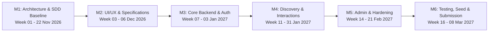

# EstateX — Project Milestones & Release Schedule

**Project:** EstateX Real Estate & Rental Platform  
**Target Completion Date:** 7 March 2027  
**Academic Submission Date:** 8 March 2027  

---

## 1. Major Project Milestones

---

## 2. Milestone Deliverables Table

| Milestone | Target Date | Primary Deliverables | Verification Gate |
|---|---|---|---|
| **Milestone 1** | 22 Nov 2026 | Complete SDD documentation, Spec Kit setup, Project Constitution, Requirements Traceability Matrix | SDD & Architecture Review |
| **Milestone 2** | 06 Dec 2026 | Component wireframes, Design System tokens, interactive UI prototype validation | Supervisor UI Sign-off |
| **Milestone 3** | 03 Jan 2027 | Express server, MongoDB schemas, JWT authentication, Seller Property CRUD | Postman API Test Suite |
| **Milestone 4** | 31 Jan 2027 | Public directory, multi-facet search/filtering, favorites bookmarking, buyer inquiries | Integrated Feature Demo |
| **Milestone 5** | 21 Feb 2027 | Admin moderation portal, KPI dashboards, rate limiting, security audit | Security & Vulnerability Audit |
| **Milestone 6** | 08 Mar 2027 | Complete automated test passes, representative seed data, academic report, viva presentation | Final Examination |
