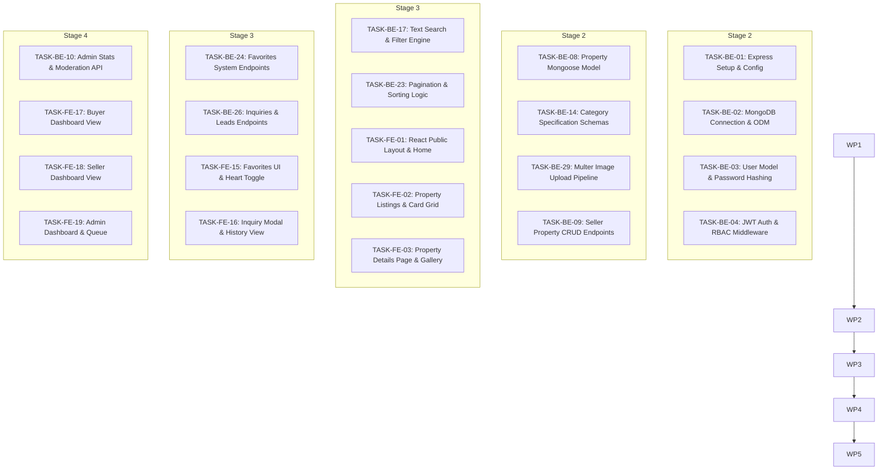

# EstateX — Development Work Breakdown Structure (WBS) & Tasks

**Document Reference:** WBS-ESTATEX-2026-V1  
**Project:** EstateX Real Estate & Rental Platform  
**Methodology:** Spec-Driven Development (SDD)  
**Execution Authorization:** HELD (Pending User Implementation Approval)  

---

## 1. Overview & Work Packages

The implementation of EstateX is broken down into modular, atomic work packages mapped directly to the Requirements Traceability Matrix.

---

## 2. Detailed Task Work Packages

### Work Package 1: Backend Server & Security Foundation
| Task ID | Task Description | Dependencies | Est. Hours | Requirement Ref |
|---|---|---|---|---|
| `TASK-BE-01` | Bootstrap Express server with CORS, Helmet, and error handling | None | 4h | `NFR-MNT-01` |
| `TASK-BE-02` | Implement Mongoose connection with reconnection logic and logs | `TASK-BE-01` | 3h | `NFR-REL-02` |
| `TASK-BE-03` | Define `User` schema with bcrypt hashing hook | `TASK-BE-02` | 4h | `FR-AUT-001`, `FR-AUT-002` |
| `TASK-BE-04` | Implement JWT sign/verify service and `verifyToken` middleware | `TASK-BE-03` | 5h | `FR-AUT-003` |
| `TASK-BE-05` | Implement `authorizeRoles` RBAC middleware | `TASK-BE-04` | 3h | `FR-AUT-004` |
| `TASK-BE-06` | Create Auth Controller (Register, Login, Me, Update Profile) | `TASK-BE-05` | 6h | `FR-AUT-001`, `FR-AUT-003` |

### Work Package 2: Property Engine & Image Handling
| Task ID | Task Description | Dependencies | Est. Hours | Requirement Ref |
|---|---|---|---|---|
| `TASK-BE-07` | Define `Property` Mongoose schema with 5 category sub-schemas | `TASK-BE-02` | 6h | `FR-LST-002`, `FR-LST-004` |
| `TASK-BE-08` | Configure Multer middleware with MIME type and 5MB size limits | `TASK-BE-01` | 4h | `FR-IMG-001`, `FR-IMG-002` |
| `TASK-BE-09` | Implement `verifyPropertyOwnership` middleware | `TASK-BE-05` | 3h | `FR-SEL-001` |
| `TASK-BE-10` | Implement Property Controller (Create, Update, Delete, GetMine) | `TASK-BE-07`, `TASK-BE-09` | 8h | `FR-SEL-001`, `FR-SEL-003` |

### Work Package 3: Search, Filtering & Public Frontend
| Task ID | Task Description | Dependencies | Est. Hours | Requirement Ref |
|---|---|---|---|---|
| `TASK-BE-11` | Build Search & Filter query builder (city, price, category, sort) | `TASK-BE-07` | 6h | `FR-SRC-001` - `FR-SRC-006` |
| `TASK-BE-12` | Implement facet pagination with limit and page parameters | `TASK-BE-11` | 3h | `FR-SRC-007` |
| `TASK-FE-01` | Scaffold Vite React application with AppRoutes and Axios client | None | 5h | `NFR-MNT-01` |
| `TASK-FE-02` | Implement `AuthContext` and token local storage persistence | `TASK-FE-01` | 5h | `FR-AUT-003` |
| `TASK-FE-03` | Build responsive Navbar, Footer, and MainLayout | `TASK-FE-01` | 6h | `FR-VIS-001` |
| `TASK-FE-04` | Build Homepage with Hero search, category cards, featured grid | `TASK-FE-03` | 8h | `FR-VIS-001` |
| `TASK-FE-05` | Build Property Listings page with sidebar filters and sort controls | `TASK-FE-04` | 8h | `FR-VIS-002`, `FR-SRC-001` |
| `TASK-FE-06` | Build Property Details page with image gallery and seller card | `TASK-FE-05` | 8h | `FR-DET-001` - `FR-DET-004` |

### Work Package 4: Interactions (Favorites & Inquiries)
| Task ID | Task Description | Dependencies | Est. Hours | Requirement Ref |
|---|---|---|---|---|
| `TASK-BE-13` | Define `Favorite` schema with compound unique index | `TASK-BE-02` | 3h | `FR-FAV-001`, `FR-FAV-002` |
| `TASK-BE-14` | Implement Favorite Controller (Toggle, GetUserFavorites) | `TASK-BE-13` | 4h | `FR-FAV-001` |
| `TASK-BE-15` | Define `Inquiry` schema with status enum | `TASK-BE-02` | 3h | `FR-INQ-001`, `FR-INQ-002` |
| `TASK-BE-16` | Implement Inquiry Controller (Submit, GetBuyerInquiries, GetSellerLeads, UpdateStatus) | `TASK-BE-15` | 6h | `FR-INQ-001` - `FR-INQ-004` |
| `TASK-FE-07` | Implement Heart bookmark button and interactive toggle state | `TASK-FE-05` | 4h | `FR-FAV-001` |
| `TASK-FE-08` | Implement Inquiry Modal form with phone/visit date validation | `TASK-FE-06` | 5h | `FR-INQ-001` |

### Work Package 5: Governance & Role Dashboards
| Task ID | Task Description | Dependencies | Est. Hours | Requirement Ref |
|---|---|---|---|---|
| `TASK-BE-17` | Implement Admin Moderation API (Pending listings, approve/reject) | `TASK-BE-07`, `TASK-BE-05` | 6h | `FR-ADM-002` |
| `TASK-BE-18` | Implement Platform KPI aggregation queries | `TASK-BE-02` | 4h | `FR-ADM-004` |
| `TASK-FE-09` | Build User Dashboard view (Saved favorites, Sent inquiries) | `TASK-FE-07`, `TASK-FE-08` | 7h | `FR-DSH-001` |
| `TASK-FE-10` | Build Seller Dashboard view (Add Property form, My Listings table, Inbound Leads) | `TASK-BE-10`, `TASK-FE-02` | 10h | `FR-DSH-002` |
| `TASK-FE-11` | Build Admin Dashboard view (KPI counters, Approval queue, User list) | `TASK-BE-17`, `TASK-BE-18` | 8h | `FR-DSH-003` |
