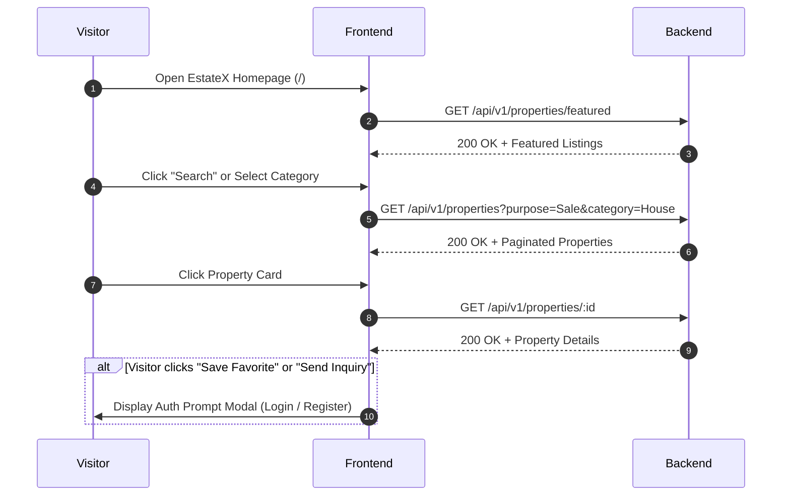

# Module Specification: Visitor Module (MOD-01)

**Module Reference:** MOD-01-VISITOR  
**Status:** Approved Baseline  
**Target Roles:** Unauthenticated Public Visitor  

---

## 1. Purpose & Scope
The Visitor Module governs the unauthenticated public browsing experience on EstateX. It allows any visitor accessing the platform to discover properties, inspect category carousels, view public listings, search by location and budget, and explore detailed property specifications without being forced to create an account immediately.

## 2. Requirements Traceability
- `FR-VIS-001`: Homepage rendering with hero search, featured properties, and category cards.
- `FR-VIS-002`: Public property directory browsing with card grid and list toggles.
- `FR-VIS-003`: Viewing complete property details, specs, and gallery.
- `FR-VIS-004`: Frictionless redirection to Login/Register upon attempting privileged actions (Favorite, Inquire).
- `FR-VIS-005`: Static information pages (About, Contact, Disclaimer).

## 3. Users & Personas
- **Primary:** Tariq Mehmood (Home Buyer browsing options before registering).
- **Secondary:** Zainab Bibi (Renter searching rental options without account commitment).

## 4. User Workflow

## 5. Business Rules
1. Only properties with `approvalStatus === "approved"` and `listingStatus === "active"` shall ever be displayed to public visitors.
2. Price must always be formatted in Pakistani numbering notation (e.g., `PKR 85 Lakhs` or `PKR 1.25 Crore`).
3. Sensitive seller information (e.g. internal notes, admin feedback) must be strictly omitted from public responses.

## 6. Dependencies
- Dependent on: `MOD-06` (Property Listing Engine), `MOD-07` (Search & Filters).
- Required by: `MOD-02` (Authentication gate upon action).

## 7. Database Planning
- Read-only operations against `properties` collection.
- Projection applied: `{ title: 1, purpose: 1, category: 1, pricePKR: 1, area: 1, location: 1, images: 1, createdAt: 1 }`.

## 8. API Planning
- `GET /api/v1/properties` (Public)
- `GET /api/v1/properties/featured` (Public)
- `GET /api/v1/properties/:id` (Public)

## 9. Validation
- Sanitization of query string parameters (`search`, `city`, `category`, `page`, `limit`).
- Reject non-alphanumeric search terms containing Mongo operator characters (`$`).

## 10. Security Considerations
- IP-based rate limiting (100 requests per 15 minutes).
- Zero user data exposure.

## 11. Acceptance Criteria
- [ ] Homepage loads in under 2 seconds on 4G connection.
- [ ] Clicking a property opens the detail view with full specifications.
- [ ] Attempting to favorite a property redirects gracefully to `/login` with a `returnUrl` parameter.

## 12. Testing Strategy
- Unit tests for price and area formatter utilities.
- Supertest integration tests verifying public endpoint accessibility without Authorization header.
