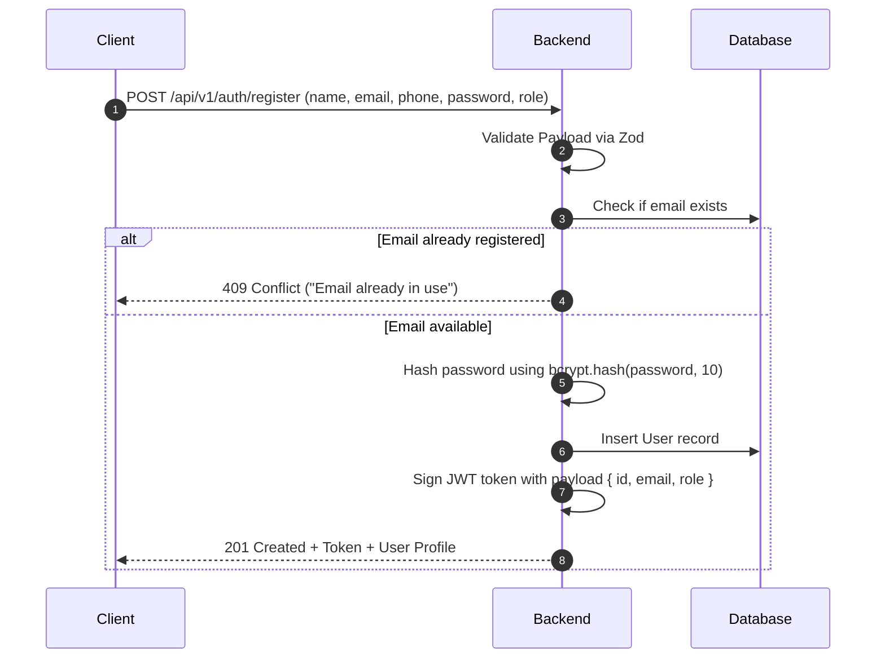

# Module Specification: Authentication & Authorization Module (MOD-02)

**Module Reference:** MOD-02-AUTH  
**Status:** Approved Baseline  
**Target Roles:** Visitor, Buyer (`user`), Seller (`seller`), Admin (`admin`)  

---

## 1. Purpose & Scope
The Authentication & Authorization Module handles identity registration, credential validation, stateless session tokens (JWT), password cryptography (bcrypt), and Role-Based Access Control (RBAC) middleware across the entire EstateX platform.

## 2. Requirements Traceability
- `FR-AUT-001`: User and Seller registration with email, phone, and password.
- `FR-AUT-002`: Password hashing with bcrypt (salt factor 10).
- `FR-AUT-003`: JWT issuance upon valid credentials.
- `FR-AUT-004`: Role-based route protection (`user`, `seller`, `admin`).
- `FR-AUT-005`: Session token invalidation on client logout.
- `NFR-SEC-01` & `NFR-SEC-02`: Cryptographic and session standards.

## 3. Users & Personas
- **Users/Buyers:** Register to save favorites and message sellers.
- **Sellers:** Register to publish and manage real estate listings.
- **Admin:** Authenticate with elevated privileges to moderate platform.

## 4. User Workflow

## 5. Business Rules
1. Email addresses are unique, case-insensitive, and normalized to lowercase.
2. Pakistani mobile number required (valid formats: `03XXXXXXXXX` or `+923XXXXXXXXX`).
3. Passwords must be at least 8 characters and include at least one digit and one letter.
4. Users cannot assign themselves the `admin` role upon registration; role selection is constrained to `['user', 'seller']`. Admin accounts are provisioned via database seeders.

## 6. Dependencies
- Core service required by all authenticated modules (`MOD-03`, `MOD-04`, `MOD-05`, `MOD-06`, `MOD-09`, `MOD-10`, `MOD-13`).

## 7. Database Planning
- Interacts with `users` collection.
- Schema: `fullName`, `email` (unique index), `passwordHash`, `phone`, `role`, `status`, `createdAt`.

## 8. API Planning
- `POST /api/v1/auth/register` (Public)
- `POST /api/v1/auth/login` (Public)
- `GET /api/v1/auth/me` (Protected: `user`, `seller`, `admin`)
- `PUT /api/v1/auth/profile` (Protected: `user`, `seller`, `admin`)

## 9. Validation
- Zod `registerSchema` enforcing field types, string lengths, regex phone validation.
- Zod `loginSchema` verifying presence of valid email and non-empty password.

## 10. Security Considerations
- Rate limiting on `/api/v1/auth/login` (10 attempts / 15 minutes per IP).
- Generic error messages on login failure ("Invalid email or password") to prevent user enumeration.
- Secure storage of `JWT_SECRET` via environment variables.

## 11. Acceptance Criteria
- [ ] User can register and immediately receives a valid JWT token.
- [ ] Attempting to login with wrong password fails with 401 Unauthorized.
- [ ] Non-admin user cannot access `/api/v1/admin/*` endpoints (returns 403 Forbidden).

## 12. Testing Strategy
- Unit tests for password hashing and token generation.
- Integration tests for registration, login, duplicate email rejection, and role protection.
