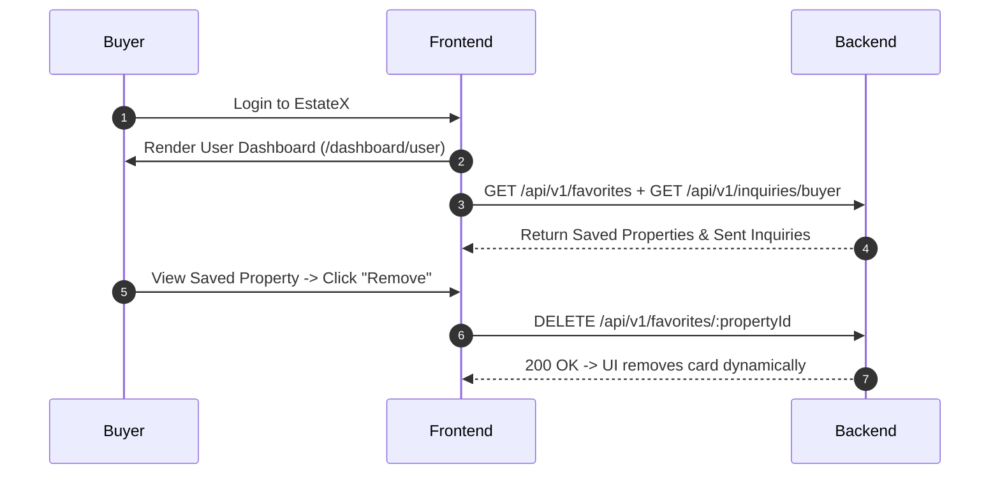

# Module Specification: Buyer / User Module (MOD-03)

**Module Reference:** MOD-03-BUYER-USER  
**Status:** Approved Baseline  
**Target Roles:** Registered Buyer / Renter (`user`)  

---

## 1. Purpose & Scope
The Buyer/User Module delivers a personalized portal for authenticated property seekers. It enables buyers and renters to manage their account profile, review bookmarked properties, manage active inquiries, and track communication with property sellers.

## 2. Requirements Traceability
- `FR-BUY-001`: Profile management for contact information.
- `FR-BUY-002`: Favorites management (viewing, deleting saved properties).
- `FR-BUY-003`: Submitting inquiries on property listings.
- `FR-BUY-004`: Viewing historical inquiries and seller response status.
- `FR-DSH-001`: Dedicated User Dashboard view.

## 3. Users & Personas
- **Tariq Mehmood:** Prospective house buyer tracking 3 shortlist houses in Bhakkar.
- **Zainab Bibi:** Apartment seeker tracking inquiries sent to 2 property managers.

## 4. User Workflow

## 5. Business Rules
1. A buyer can only inspect their own profile, favorites, and inquiries.
2. A buyer cannot access seller management pages (`/dashboard/seller`) without switching or upgrading account type.
3. Inquiry logs must show the target property thumbnail, seller name, submitted date, and status.

## 6. Dependencies
- Dependent on: `MOD-02` (Auth), `MOD-08` (Property Details), `MOD-09` (Favorites), `MOD-10` (Inquiry).

## 7. Database Planning
- Queries `users` for profile, `favorites` joined with `properties`, and `inquiries` joined with `properties`.

## 8. API Planning
- `GET /api/v1/auth/me`
- `PUT /api/v1/auth/profile`
- `GET /api/v1/favorites`
- `GET /api/v1/inquiries/buyer`

## 9. Validation
- Profile update validation: Name (2-100 characters), Phone (valid Pakistani format).

## 10. Security Considerations
- Route protection via `verifyToken` middleware.
- Resource filtering strictly parameterized by `req.user.id`.

## 11. Acceptance Criteria
- [ ] User Dashboard renders summary badges: Total Favorites, Total Inquiries.
- [ ] Buyer can update phone number and see changes reflected immediately.
- [ ] Buyer can view full details of past submitted inquiries.

## 12. Testing Strategy
- Integration tests ensuring buyer endpoints reject unauthenticated requests.
- Contract test verifying buyer cannot query another user's inquiry logs.
