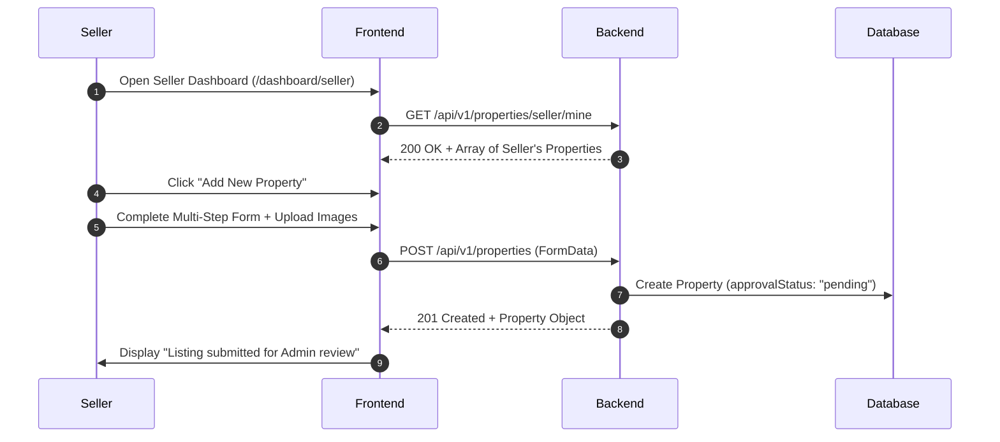

# Module Specification: Seller Module (MOD-04)

**Module Reference:** MOD-04-SELLER  
**Status:** Approved Baseline  
**Target Roles:** Registered Property Seller / Owner (`seller`)  

---

## 1. Purpose & Scope
The Seller Module provides property owners, developers, and agents with a management portal to create, edit, publish, monitor, and remove property listings across the five Pakistan property categories. It also provides an inquiries inbox to review and respond to incoming buyer leads.

## 2. Requirements Traceability
- `FR-SEL-001`: Publishing and updating property listings.
- `FR-SEL-002`: Seller Management Dashboard.
- `FR-SEL-003`: Toggling listing status (`Active`, `Sold`, `Rented`).
- `FR-SEL-004`: Reviewing incoming buyer inquiries with contact details.
- `FR-DSH-002`: Dedicated Seller Dashboard KPIs.

## 3. Users & Personas
- **Malik Arshad:** Farmland and commercial shop owner managing multiple active listings in Bhakkar district.

## 4. User Workflow

## 5. Business Rules
1. Only users with `role: "seller"` or `role: "admin"` may create or modify listings.
2. A seller may only edit or delete properties where `property.sellerId === req.user.id`.
3. Newly created or substantially edited properties enter `approvalStatus: "pending"` and require admin review before appearing in public directory.
4. Marking a property as `Sold` or `Rented` hides it from public search results while preserving inquiry records.

## 6. Dependencies
- Dependent on: `MOD-02` (Auth), `MOD-06` (Property Listing Engine), `MOD-11` (Image Management), `MOD-10` (Inquiry Engine).

## 7. Database Planning
- Direct mutations on `properties` collection filtered by `sellerId`.
- Read operations on `inquiries` collection filtered by `sellerId`.

## 8. API Planning
- `POST /api/v1/properties` (Seller, Admin)
- `PUT /api/v1/properties/:id` (Seller, Admin)
- `DELETE /api/v1/properties/:id` (Seller, Admin)
- `PATCH /api/v1/properties/:id/status` (Seller, Admin)
- `GET /api/v1/inquiries/seller` (Seller, Admin)

## 9. Validation
- Comprehensive listing validation (title, description, price, area, category, purpose, address, city).
- Ownership verification middleware (`verifyPropertyOwnership`).

## 10. Security Considerations
- Authorization middleware enforces `role: "seller"`.
- Strict ownership checks prevent horizontal privilege escalation (IDOR attacks).

## 11. Acceptance Criteria
- [ ] Seller can successfully post a property listing with up to 10 photos.
- [ ] Seller dashboard displays active listings count, pending approval count, and inquiry count
- [ ] Seller can mark a property as `Sold` with immediate status update.

## 12. Testing Strategy
- Ownership verification unit tests (asserting 403 Forbidden when seller A attempts to edit seller B's listing).
- Supertest integration tests for listing CRUD operations.
