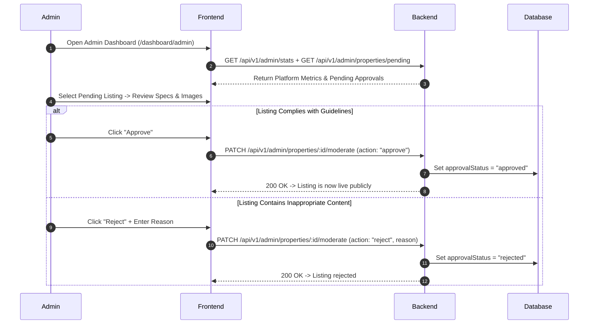

# Module Specification: Admin Moderation Module (MOD-05)

**Module Reference:** MOD-05-ADMIN  
**Status:** Approved Baseline  
**Target Roles:** System Administrator (`admin`)  

---

## 1. Purpose & Scope
The Admin Moderation Module provides platform operators with governance controls to supervise listings, review new submissions, approve or reject listings with notes, manage registered user and seller accounts, suspend fraudulent actors, and monitor overall platform health.

## 2. Requirements Traceability
- `FR-ADM-001`: Strict administrative route protection.
- `FR-ADM-002`: Review queue for listing approval and rejection.
- `FR-ADM-003`: User account moderation (suspension / reactivation).
- `FR-ADM-004`: Platform-wide KPI aggregation.
- `FR-DSH-003`: Admin Dashboard view.

## 3. Users & Personas
- **Wasi Ashraf:** Platform Administrator conducting content hygiene and system oversight.

## 4. User Workflow

## 5. Business Rules
1. Only authenticated users with `role: "admin"` may invoke administrative endpoints.
2. Admins cannot delete their own admin account.
3. Approving a listing transitions `approvalStatus` from `pending` to `approved`, immediately making it indexable by the search engine.
4. Suspending a user immediately revokes their ability to create listings or submit inquiries.

## 6. Dependencies
- Dependent on: `MOD-02` (Auth), `MOD-06` (Property Listing Engine).

## 7. Database Planning
- Aggregations across `users`, `properties`, and `inquiries` collections.
- Status update mutations on `users` and `properties`.

## 8. API Planning
- `GET /api/v1/admin/stats`
- `GET /api/v1/admin/users`
- `PATCH /api/v1/admin/users/:id/status`
- `GET /api/v1/admin/properties/pending`
- `PATCH /api/v1/admin/properties/:id/moderate`

## 9. Validation
- Moderate schema: `action` enum `['approve', 'reject']`, optional string `reason` (max 500 chars).

## 10. Security Considerations
- Mandatory two-stage guard: `verifyToken` AND `authorizeRoles('admin')`.
- All moderation actions recorded in audit log.

## 11. Acceptance Criteria
- [ ] Admin dashboard displays counts of total users, total sellers, active listings, and pending listings.
- [ ] Approving a listing renders it visible on the public `/listings` page.
- [ ] Non-admin user receives 403 Forbidden on any `/api/v1/admin/*` endpoint.

## 12. Testing Strategy
- Security tests verifying RBAC rejection for non-admin tokens.
- Integration tests for approval/rejection lifecycle.
