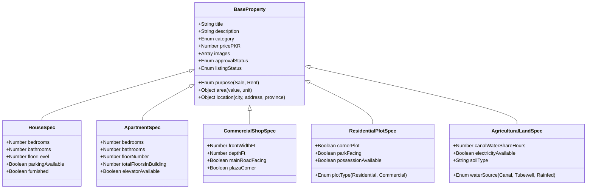

# Module Specification: Property Listing Engine (MOD-06)

**Module Reference:** MOD-06-PROPERTY-LISTING  
**Status:** Approved Baseline  
**Target Roles:** Seller (`seller`), Admin (`admin`)  

---

## 1. Purpose & Scope
The Property Listing Engine is the core data management service of EstateX. It structures, validates, stores, and modifies real estate listings across the 5 approved Pakistani property categories (Houses, Apartments, Commercial Shops, Residential Plots, Agricultural Land) and the 2 transaction purposes (`Sale` and `Rent`).

## 2. Requirements Traceability
- `FR-LST-001`: Two commercial transaction purposes: `Sale` and `Rent`.
- `FR-LST-002`: Five Pakistan property categories: `House`, `Apartment`, `Commercial Shop`, `Residential Plot`, `Agricultural Land`.
- `FR-LST-003`: Mandatory attributes (Title, Description, Purpose, Category, Price in PKR, Area, City, Address).
- `FR-LST-004`: Category-specific specifications (e.g. bedrooms for houses; tubewell and water share for agricultural land).

## 3. Users & Personas
- **Malik Arshad (Seller):** Publishes a 12-Acre agricultural land parcel and a 5-Marla commercial shop.
- **Wasi Ashraf (Admin):** Manages listing integrity and categorization.

## 4. Multi-Category Specification Matrix

## 5. Business Rules
1. Prices must be specified in Pakistani Rupees (PKR) and strictly greater than zero.
2. Areas must be specified in one of: `Marla`, `Kanal`, or `SqFt`.
3. Standard conversion reference: 1 Kanal = 20 Marlas; 1 Marla = 225 or 272 Sq. Ft. (system defaults to 225 sq ft standard).
4. Each listing must contain at least 1 verified photograph (maximum 10).

## 6. Dependencies
- Dependent on: `MOD-02` (Auth), `MOD-11` (Image Management), `MOD-12` (Location Management).
- Feeds: `MOD-07` (Search & Filter), `MOD-08` (Details), `MOD-09` (Favorites), `MOD-10` (Inquiries).

## 7. Database Planning
- Stored in `properties` collection.
- Embedded `specifications` subdocument allows category-specific attributes without schema pollution.

## 8. API Planning
- `POST /api/v1/properties`
- `PUT /api/v1/properties/:id`
- `DELETE /api/v1/properties/:id`
- `PATCH /api/v1/properties/:id/status`

## 9. Validation
- Strict Zod schema enforcing enum values for `category` and `purpose`.
- Conditional schema branches based on category (e.g. if category is `House`, `bedrooms` is required).

## 10. Security Considerations
- Owner verification on all update/delete routes.
- HTML sanitization on property description to prevent XSS.

## 11. Acceptance Criteria
- [ ] Seller can create a House listing with bedroom/bathroom counts.
- [ ] Seller can create an Agricultural Land listing with water source and tubewell info.
- [ ] Listing enters `approvalStatus: "pending"` by default.

## 12. Testing Strategy
- Unit tests validating category-specific Zod schemas.
- Integration tests for property lifecycle (Draft -> Pending -> Approved -> Active -> Sold).
