# Module Specification: Property Search & Filter Module (MOD-07)

**Module Reference:** MOD-07-SEARCH-FILTER  
**Status:** Approved Baseline  
**Target Roles:** Visitor, Buyer (`user`), Seller (`seller`), Admin (`admin`)  

---

## 1. Purpose & Scope
The Property Search & Filter Module delivers a fast, flexible, and accurate query engine for exploring EstateX listings. It supports full-text search, multi-attribute facet filtering (purpose, category, city, price range, area), sorting options, and paginated results.

## 2. Requirements Traceability
- `FR-SRC-001`: Keyword search across title, description, and locality.
- `FR-SRC-002`: Purpose filter (`Sale`, `Rent`).
- `FR-SRC-003`: Category filter (Houses, Apartments, Shops, Plots, Agriculture).
- `FR-SRC-004`: City/District filter (Bhakkar, Lahore, Islamabad, etc.).
- `FR-SRC-005`: Numerical price range slider/inputs (Min and Max PKR).
- `FR-SRC-006`: Sorting by Price and Date.
- `FR-SRC-007`: Server-side pagination.

## 3. Users & Personas
- **Tariq Mehmood:** Filters for "Houses" for "Sale" in "Bhakkar" between "PKR 50 Lakhs" and "PKR 1 Crore".
- **Zainab Bibi:** Filters for "Apartments" for "Rent" in "Islamabad" with max price "PKR 40,000".

## 4. Search & Filter Pipeline

```mermaid
flowchart LR
    ClientQuery[URL Query String: ?city=Bhakkar&purpose=Sale&category=House&minPrice=5000000&maxPrice=10000000&page=1] --> QueryParser[Express Query Parser & Zod Sanitizer]
    QueryParser --> FilterBuilder[Mongoose Query Builder]
    FilterBuilder --> CompoundIndex[MongoDB Compound Index Match]
    CompoundIndex --> Paginator[Facet Pagination & Count]
    Paginator --> Envelope[API Standard Response Envelope]
    Envelope --> ReactGrid[React PropertyGrid Component]
```

## 5. Business Rules
1. Only approved and active properties are queryable: `{ approvalStatus: "approved", listingStatus: "active" }`.
2. Pagination limit is capped at a maximum of 24 listings per page (default is 12).
3. If no search results match, the response returns an empty array `[]` with `total: 0` (never a 404).

## 6. Dependencies
- Dependent on: `MOD-06` (Property Listing Engine), `MOD-12` (Location Management).

## 7. Database Planning
- Utilizes MongoDB compound indexes:
  `{ approvalStatus: 1, listingStatus: 1, "location.city": 1, category: 1, purpose: 1, pricePKR: 1 }`
- Text index on `{ title: "text", description: "text" }`.

## 8. API Planning
- `GET /api/v1/properties`
  - Parameters: `search`, `city`, `purpose`, `category`, `minPrice`, `maxPrice`, `minArea`, `maxArea`, `bedrooms`, `sort`, `page`, `limit`.

## 9. Validation
- Numerical coercion on `minPrice`, `maxPrice`, `page`, and `limit`.
- Enum validation on `purpose`, `category`, and `sort` (`price_asc`, `price_desc`, `date_desc`, `date_asc`).

## 10. Security Considerations
- Protection against NoSQL query operator injection (`express-mongo-sanitize`).
- Rate limiting prevents denial-of-service through complex query spam.

## 11. Acceptance Criteria
- [ ] Applying city filter `Bhakkar` returns only properties located in Bhakkar.
- [ ] Applying price range filter filters strictly within inclusive bounds.
- [ ] Sorting by `price_asc` returns properties in ascending price sequence.
- [ ] Paginated metadata (`page`, `limit`, `totalPages`, `total`) matches returned payload.

## 12. Testing Strategy
- Unit tests for query object generation.
- Integration test suite running across a pre-seeded test database checking filter combinations.
