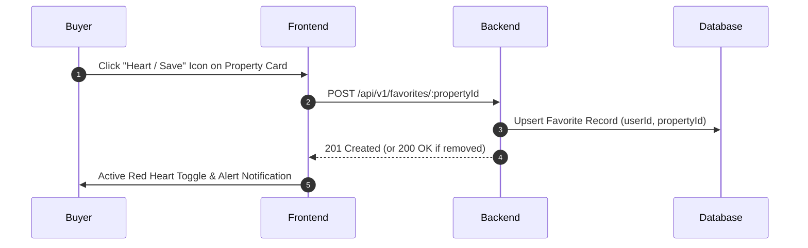

# Module Specification: Favorites Module (MOD-09)

**Module Reference:** MOD-09-FAVORITES  
**Status:** Approved Baseline  
**Target Roles:** Authenticated Buyer (`user`), Seller (`seller`)  

---

## 1. Purpose & Scope
The Favorites Module allows authenticated users to bookmark properties they are interested in, curate a shortlist of candidate properties, access their saved list from the User Dashboard, and remove properties from their favorites list at will.

## 2. Requirements Traceability
- `FR-FAV-001`: Toggle favorite on property cards and detail view.
- `FR-FAV-002`: Prevention of duplicate bookmarks via compound uniqueness.
- `FR-FAV-003`: Managing and viewing saved properties in User Dashboard.

## 3. Users & Personas
- **Tariq Mehmood:** Saves 3 candidate houses to compare prices and discuss with his family.

## 4. User Workflow

## 5. Business Rules
1. Only authenticated users can save properties.
2. An attempt to favorite an already bookmarked property acts as a toggle (or returns a clear idempotent success).
3. Deleting a property listing cascades to remove or deactivate related favorite entries.

## 6. Dependencies
- Dependent on: `MOD-02` (Auth), `MOD-06` (Property Listing).
- Feeds: `MOD-03` (Buyer Profile), `MOD-13` (User Dashboard).

## 7. Database Planning
- Dedicated collection: `favorites`.
- Schema: `{ userId: ObjectId, propertyId: ObjectId, createdAt: Date }`.
- Compound unique index: `{ userId: 1, propertyId: 1 }`.

## 8. API Planning
- `GET /api/v1/favorites` (Protected: `user`, `seller`)
- `POST /api/v1/favorites/:propertyId` (Protected: `user`, `seller`)
- `DELETE /api/v1/favorites/:propertyId` (Protected: `user`, `seller`)

## 9. Validation
- `propertyId` validated as a valid MongoDB ObjectId.
- Verifies that the referenced property exists and is not soft-deleted.

## 10. Security Considerations
- The `userId` is always extracted from `req.user.id` (never from request body/query) to prevent saving favorites on behalf of another user.

## 11. Acceptance Criteria
- [ ] Authenticated user can bookmark and unbookmark a property.
- [ ] User Dashboard displays accurate list of favorited properties.
- [ ] Database prevents duplicate entries for the same user and property.

## 12. Testing Strategy
- Unit test for compound index constraint.
- Supertest integration tests for bookmarking, listing, and unbookmarking.
