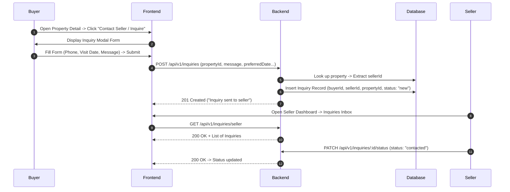

# Module Specification: Inquiry & Lead Management Module (MOD-10)

**Module Reference:** MOD-10-INQUIRY  
**Status:** Approved Baseline  
**Target Roles:** Authenticated Buyer (`user`), Seller (`seller`), Admin (`admin`)  

---

## 1. Purpose & Scope
The Inquiry & Lead Management Module facilitates structured, direct communication between prospective buyers/renters and property sellers. It allows buyers to submit inquiries with contact details, proposed visit dates, and specific questions, and provides sellers with an inquiry dashboard to manage leads.

## 2. Requirements Traceability
- `FR-INQ-001`: Inquiry form submission with name, phone, email, message, and visit date.
- `FR-INQ-002`: Automated association of buyer and seller IDs.
- `FR-INQ-003`: Seller Inquiries Inbox view.
- `FR-INQ-004`: Inquiry status tracking (`new`, `contacted`, `closed`).

## 3. Users & Personas
- **Tariq Mehmood (Buyer):** Inquires about possession status and requests a weekend property walkthrough.
- **Malik Arshad (Seller):** Receives the inquiry, views Tariq's phone number, calls him, and marks the lead as `contacted`.

## 4. User Workflow

## 5. Business Rules
1. A seller cannot submit an inquiry on their own property listing.
2. Inquiry messages are restricted to a maximum of 1,000 characters.
3. Phone numbers must be valid Pakistani telephone numbers to ensure sellers can contact prospective buyers.

## 6. Dependencies
- Dependent on: `MOD-02` (Auth), `MOD-06` (Property Listing).
- Feeds: `MOD-03` (Buyer Dashboard), `MOD-04` (Seller Dashboard), `MOD-13` (Dashboards).

## 7. Database Planning
- Stored in `inquiries` collection.
- Schema: `{ propertyId, buyerId, sellerId, buyerName, buyerEmail, buyerPhone, message, preferredDate, status, createdAt }`.
- Indexes on `sellerId` and `buyerId`.

## 8. API Planning
- `POST /api/v1/inquiries`
- `GET /api/v1/inquiries/buyer`
- `GET /api/v1/inquiries/seller`
- `PATCH /api/v1/inquiries/:id/status`

## 9. Validation
- Zod `inquirySchema` validating required contact details and message length.
- Business rule check: `property.sellerId.toString() !== req.user.id`.

## 10. Security Considerations
- Sellers can only view inquiries addressed to them.
- Buyers can only view inquiries submitted by them.
- Admins possess audit visibility over all platform inquiries.

## 11. Acceptance Criteria
- [ ] Buyer submits inquiry and sees it reflected in their Buyer Dashboard history.
- [ ] Seller immediately sees new inquiry with buyer contact information.
- [ ] Seller can update status to `contacted`.

## 12. Testing Strategy
- Unit tests validating rejection of self-inquiries.
- Supertest integration tests verifying cross-user isolation of inquiry feeds.
