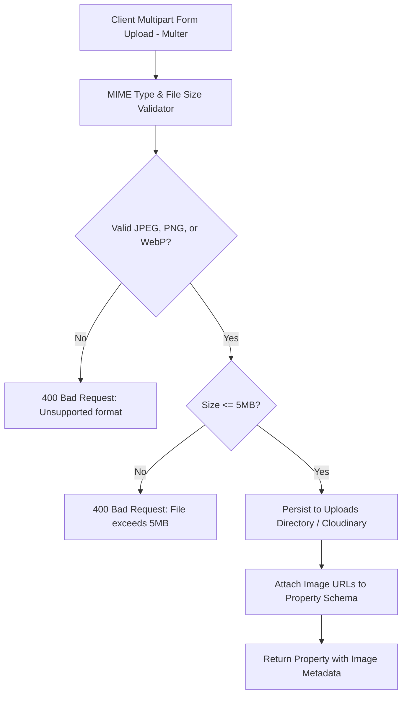

# Module Specification: Property Image Management Module (MOD-11)

**Module Reference:** MOD-11-IMAGE-MANAGEMENT  
**Status:** Approved Baseline  
**Target Roles:** Seller (`seller`), Admin (`admin`)  

---

## 1. Purpose & Scope
The Property Image Management Module handles the uploading, validation, optimization, storage, and association of property photographs. It ensures that listings are supported by high-quality visual media while enforcing storage limits, file format restrictions, and security screening.

## 2. Requirements Traceability
- `FR-IMG-001`: Upload 1 to 10 photos per listing.
- `FR-IMG-002`: Validation of MIME types (JPEG, PNG, WebP) and maximum 5MB file size.
- `FR-IMG-003`: Designation of a primary thumbnail image for cards.
- `FR-IMG-004`: Removal of associated images upon listing deletion.
- `NFR-PERF-04`: Image compression and web optimization.

## 3. Users & Personas
- **Malik Arshad (Seller):** Uploads 6 clear photographs of a residential house (exterior facade, bedrooms, kitchen, street).

## 4. Image Processing Pipeline


## 5. Business Rules
1. Every published listing must contain at least 1 image.
2. The first image uploaded is designated `isPrimary: true` by default unless explicitly configured otherwise.
3. Maximum allowed photos per listing is 10.
4. Executable files, SVGs with embedded scripts, and non-image extensions are strictly blocked.

## 6. Dependencies
- Dependent on: `MOD-02` (Auth).
- Required by: `MOD-06` (Property Listing), `MOD-08` (Property Details).

## 7. Database Planning
- Embedded in `properties.images`:
```json
[
  {
    "url": "/uploads/properties/prop_673da_01.webp",
    "publicId": "prop_673da_01",
    "isPrimary": true
  }
]
```

## 8. API Planning
- Handled directly within `POST /api/v1/properties` and `PUT /api/v1/properties/:id` via `multipart/form-data`.
- Dedicated thumbnail update: `PATCH /api/v1/properties/:id/primary-image`.

## 9. Validation
- Multer file filter verifying `file.mimetype in ['image/jpeg', 'image/png', 'image/webp']`.
- File size limit: `5 * 1024 * 1024` bytes.

## 10. Security Considerations
- Prevention of file upload attacks (path traversal, malicious script execution).
- Renaming all files with unique random hashes (e.g. `crypto.randomUUID() + extension`).

## 11. Acceptance Criteria
- [ ] Uploading a 2MB JPEG image succeeds and stores file safely.
- [ ] Attempting to upload a `.pdf` or `.exe` fails immediately with 400 Bad Request.
- [ ] Attempting to upload more than 10 images triggers a validation error.

## 12. Testing Strategy
- Unit tests for Multer file filter functions.
- Integration tests uploading mock image buffers using Supertest `.attach()`.
