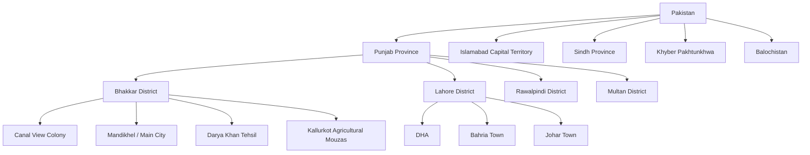

# Module Specification: Property Location Management Module (MOD-12)

**Module Reference:** MOD-12-LOCATION-MANAGEMENT  
**Status:** Approved Baseline  
**Target Roles:** System, Visitor, Buyer, Seller  

---

## 1. Purpose & Scope
The Property Location Management Module establishes a standardized geographical hierarchy tailored for Pakistan real estate. It ensures uniform indexing and filtering across provinces, administrative divisions, cities/districts (with primary focus on Bhakkar and major cities), localities, and sectors/mouzas.

## 2. Requirements Traceability
- `FR-LOC-001`: Hierarchical location structure (Country -> Province -> City/District -> Locality/Address).
- `FR-LOC-002`: Optional latitude/longitude coordinates for map integration.
- `FR-LOC-003`: Database indexing on city and area fields for sub-50ms search.

## 3. Pakistan Location Hierarchy



## 4. Supported Cities Catalog (Baseline)
- **Primary Focus:** Bhakkar
- **Key Metropolitan Centers:** Lahore, Islamabad, Rawalpindi, Multan, Faisalabad, Karachi, Peshawar, Quetta
- **Extensible Schema:** System supports adding any recognized Pakistani district or tehsil.

## 5. Business Rules
1. Property location must always identify a valid Pakistani city and street/locality address.
2. Province defaults to `Punjab` when city is `Bhakkar`, `Lahore`, `Rawalpindi`, or `Multan`.
3. Coordinates (latitude/longitude), when provided, must fall within Pakistan's geographical bounding box (`Lat: 23.5 to 37.0 N`, `Lon: 60.5 to 77.5 E`).

## 6. Dependencies
- Feeds: `MOD-06` (Property Listing), `MOD-07` (Search & Filtering), `MOD-08` (Details).

## 7. Database Planning
- Embedded in `properties.location`:
```json
{
  "address": "Canal View Colony, Near Jhang Road",
  "city": "Bhakkar",
  "province": "Punjab",
  "postalCode": "30000",
  "coordinates": {
    "lat": 31.6269,
    "lng": 71.0655
  }
}
```
- B-Tree Index on `properties.location.city`.

## 8. API Planning
- `GET /api/v1/locations/cities` (Public: Returns list of available cities with active listings).

## 9. Validation
- Non-empty city string validation against normalized city names.
- Coordinate range validation (`-90 <= lat <= 90`, `-180 <= lng <= 180`).

## 10. Security Considerations
- Addresses sanitized to prevent cross-site scripting (XSS).

## 11. Acceptance Criteria
- [ ] Filtering listings by city "Bhakkar" retrieves all Bhakkar listings instantly.
- [ ] Location hierarchy persists cleanly across all 5 property categories.

## 12. Testing Strategy
- Unit test verifying Pakistani coordinate range validator.
- Integration tests querying listings by city name.
