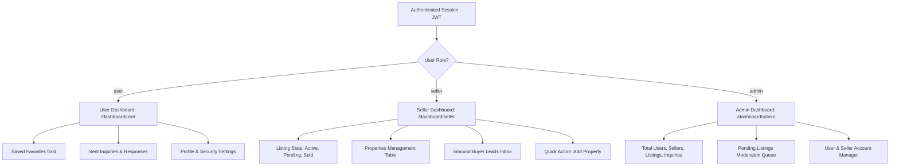

# Module Specification: Role-Specific Dashboards (MOD-13)

**Module Reference:** MOD-13-DASHBOARDS  
**Status:** Approved Baseline  
**Target Roles:** Buyer (`user`), Seller (`seller`), Admin (`admin`)  

---

## 1. Purpose & Scope
The Dashboards Module provides tailored command centers for each authenticated role. It aggregates vital metrics, action shortcuts, listing controls, and inquiry management in three distinct portals:
1. **User / Buyer Dashboard:** Personal favorites, inquiry history, account profile.
2. **Seller Dashboard:** Property listing management, listing statuses, inbound leads, performance stats.
3. **Admin Dashboard:** Platform KPIs, listing moderation queue, user account governance.

## 2. Requirements Traceability
- `FR-DSH-001`: User / Buyer Dashboard view.
- `FR-DSH-002`: Seller Management Dashboard view.
- `FR-DSH-003`: Administrative Governance Dashboard view.
- `FR-AUT-004`: Role-based protection of dashboard routes.

## 3. Dashboard Architectural Matrix

## 4. Dashboard Features by Role

### 4.1 User Dashboard (`/dashboard/user`)
- **Saved Properties:** Card carousel/grid of bookmarked listings with quick remove option.
- **My Inquiries:** Timeline list of inquiries sent to sellers with status badges (`New`, `Contacted`, `Closed`).
- **Profile Details:** Edit name, mobile number, and update password.

### 4.2 Seller Dashboard (`/dashboard/seller`)
- **Listing Metrics:** Counters for Active Listings, Pending Admin Approval, Sold Listings, and New Inquiries.
- **My Properties:** Tabular list with thumbnail, title, price, category, status dropdown (`Active`, `Sold`, `Rented`), and Edit/Delete buttons.
- **Inquiries Inbox:** List of prospective buyers with phone numbers, visit date requests, and direct call shortcuts.

### 4.3 Admin Dashboard (`/dashboard/admin`)
- **Platform Analytics:** Total registered buyers, total active sellers, total live properties, total inquiries.
- **Moderation Queue:** Pending property listings awaiting approval or rejection.
- **User Accounts:** Searchable table of registered accounts with instant `Active` / `Suspended` toggles.

## 5. Business Rules
1. A user cannot access a dashboard belonging to a different role; attempting to access `/dashboard/admin` as a `user` triggers a 403 Forbidden redirect.
2. Dashboard statistics are calculated on-the-fly or cached to maintain responsiveness.

## 6. Dependencies
- Integrates all platform modules (`MOD-01` through `MOD-12`).

## 7. Database Planning
- Aggregation pipelines on `users`, `properties`, and `inquiries`.

## 8. API Planning
- `GET /api/v1/auth/me`
- `GET /api/v1/favorites`
- `GET /api/v1/inquiries/buyer`
- `GET /api/v1/properties/seller/mine`
- `GET /api/v1/inquiries/seller`
- `GET /api/v1/admin/stats`
- `GET /api/v1/admin/properties/pending`
- `GET /api/v1/admin/users`

## 9. Validation
- RBAC middleware verifies token claims against target dashboard route.

## 10. Security Considerations
- Zero cross-tenant data leakage: seller queries strictly scoped by `sellerId: req.user.id`.

## 11. Acceptance Criteria
- [ ] Buyer accessing `/dashboard/user` sees their personal favorites and sent inquiries.
- [ ] Seller accessing `/dashboard/seller` sees their listings and received leads.
- [ ] Admin accessing `/dashboard/admin` sees platform-wide KPIs and moderation queues.

## 12. Testing Strategy
- Route protection tests for each dashboard route across all role types.
- Component integration tests verifying dashboard metric rendering.
